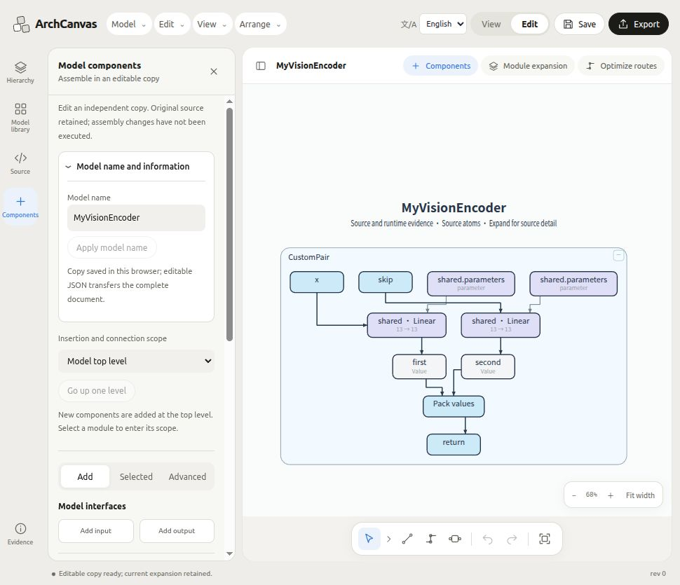
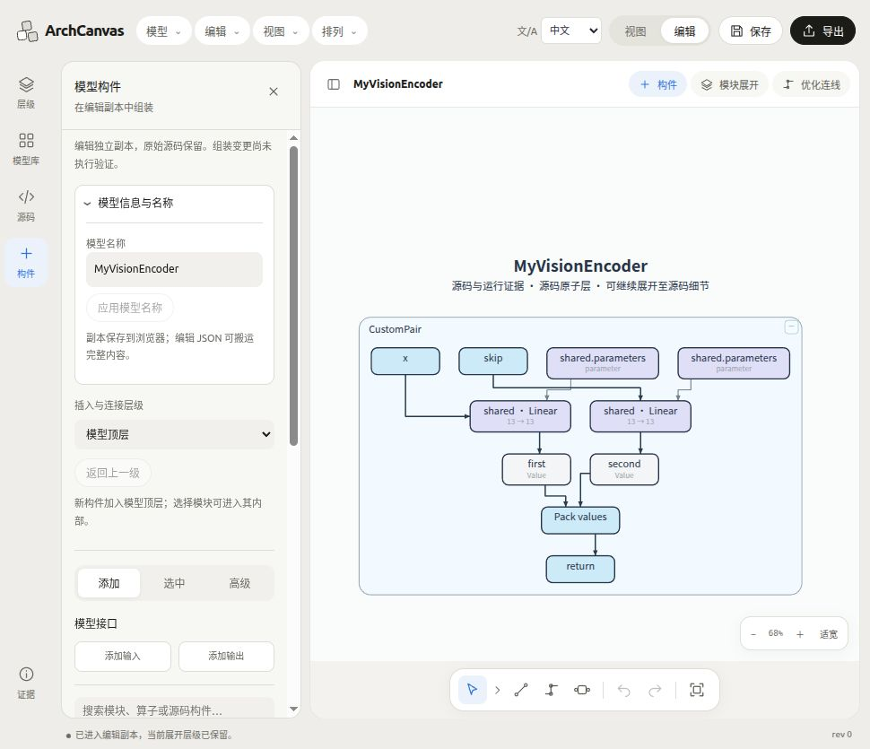
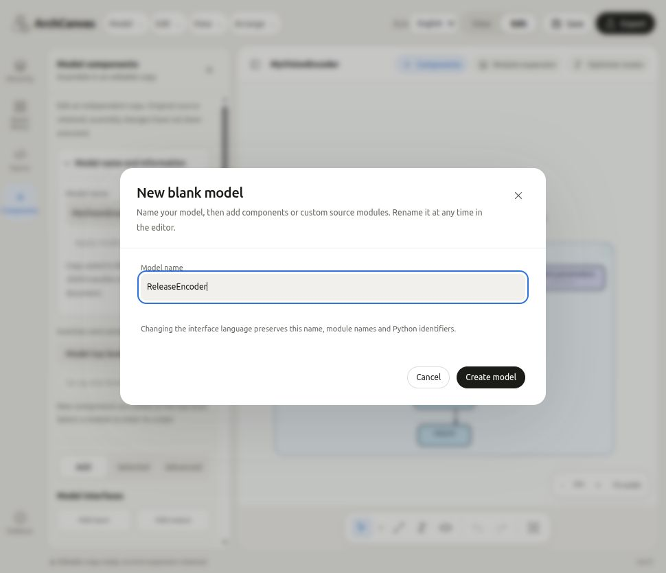

# 界面语言、从零搭建与命名验证（2026-10-29）

本次修改位于正式工程 `ArchCanvas_Model_Architecture_Studio`。没有引入失败 Temp 工程的运行时，没有将视觉连线转换为 Python 源码。

## 已实现的行为

- 顶栏增加“界面语言 / Interface language”，支持中文和 English。语言选择保存在浏览器；切换时不重新挂载工作区或预览 iframe，不清空组装稿、选区、展开状态和撤销记录。
- React 控件显式使用 UI 字典；预览通过同源消息同步语言。菜单、提示、表单、可访问性标签和自动生成的画布阅读注释随界面切换。
- 模型和模块标题、用户别名、Python 标识符、源码、构造参数、槽位及证据内容均作为数据保留。不会对源码或整个图的任意文本执行翻译。
- 画布自动阅读注释仅在最终 DOM 显示层标记和翻译，保留其原始占位宽度。保存的 `node.html`、原始 IR 和内容摘要保持原样，避免旧文档恢复时触发生成图元一致性校验。SVG 导出沿用可见 DOM。
- “模型 → 新建空白模型”增加命名表单；去除首尾空白，限制为 1–240 字符，拒绝控制字符，失败时保留已输入名称。创建后可在编辑面板顶部直接改名。
- 名称区默认展开；“源码模块与参数重解析”入口移到添加/选中区域；组合命名、节点名称和模型名称仍分别作用于各自对象。默认组合名使用 `CustomGroup`，基础模块名称保持英文。

语言入口位于 `studio/src/LanguageSelector.tsx`，字典和消息处理位于 `studio/src/i18n.ts`、`studio/src/locales/en.json`。预览字典由 `studio/scripts/sync-ui-locales.mjs` 同步，构建自动运行；`--check` 可检查漂移。增加第三种语言时，需要添加 Locale/字典及选项，并扩展 `studio-locale.js` 的语言验证、字典载入和展开控件前缀处理；不能将模块数据送入 UI 翻译器。

## 全案例从零搭建的范围与结果

当前原生语义模型库有 **43 个模型配置（42 份不同源码程序）**。全部通过两种结构重建：

1. 从零节点文档开始，按源码模块分解后逐个加入，再恢复跨构件连接。
2. 从零节点文档开始，按源码原子分解后逆序加入，再恢复跨构件连接。子节点可以早于容器加入。

重建使用与编辑面板“高级 → 原始构件精确重建”相同的 `SemanticAuthoring.recipe/add/restoreConnection` 操作能力。自动化覆盖全部配置；没有声称对每个配置进行了逐次人工点击。完成后逐字段比较完整 IR，检查原始身份、父子层级、操作数槽位与依赖；模块重建还验证便携保存恢复、原生视图接受以及 `recipe.exact`。

- 合计：6,874 个节点、6,975 条依赖。
- 最大案例：Transformer，3,371 个节点、3,663 条依赖；13 个模块构件或 3,371 个原子构件。
- 逐配置结果见 [rebuild-report.json](evidence/language-and-rebuild-20261029/rebuild-report.json)。

这是**有原始参考 IR 的结构精确重建**。不证明仅凭基础积木就能推导任意源码、不证明任意新连接满足 shape，也不证明生成的 Python 与原模型等价。编辑副本仍保持“组装声明”权限。

为使结构矩阵可重复，视图检查使用零预算布线，不要求完成全部线路搜索。43 个配置合计有 **592 条待布线或失败标记**，不能把原生结构接受解释成全部连线排版完成。真实路由、展开移动和交互延迟另有回归检查。

## 自定义源码验证

使用 `CustomPair(width=13)`，包含两个输入、共享 Linear 的两次调用和元组返回。源码顶层插入 `raise RuntimeError("AST_ONLY_SENTINEL")`，静态解析仍成功，证明测试路径没有执行源码。

验证：加入空白模型、参数保留、替换接口保护、模型改名、源码节点/依赖不变，以及保存恢复。元组返回按一个结构化返回值处理，保留两个操作数槽位，不伪造两个独立输出接口。

真实浏览器中创建了命名模型，将自定义源码解析加入，改名为 `MyVisionEncoder`，展开 `CustomPair`，保存刷新，并在中英文之间切换。模型名、`CustomPair`、`Linear`、`x`、`skip`、`first`、`second` 均保留；刷新后模型、语言和展开状态恢复。

## 检查结果与发布边界

以下检查分别运行，存在交叠，数量不累加：

| 检查 | 结果 | 证据 |
| --- | --- | --- |
| 全案例重建、自定义源码、便携文档、展开拖动/延迟、面板、语言、层级与缓存升级 | 93 通过，无跳过 | `acceptance-final.log` |
| 最终语言与交互提示覆盖、React 控件、主程序工作流、预览消息顺序、层级 | 65 通过，无跳过 | `locale-host-final.log` |
| 模型目录与当前 Transformer 配置、主程序工作流等补充检查 | 104 通过，无跳过 | `host-final.log` |
| 预览语言同源消息、名称隔离、无障碍标签、注释宽度与往返恢复、拖动延迟和消息顺序 | 17 通过，无跳过 | `preview-locale-final.log` |
| Python Summary 语义桥接和组装桥接 | 12 通过，无跳过 | `python-focused.log` |
| 路由及源码适配检查 | 初次 54/55；旧缓存版本断言 19 已更新到当前 20，随后在 93 项中通过复验 | `route-harness-final.log`、`acceptance-final.log` |
| 最后修改后的文档恢复、主程序预览和中英文显示层复验 | 36 通过，无跳过 | `last-final.log` |
| TypeScript / Vite 正式构建 | 通过；保留既有大包体警告 | `build-final.log` |
| 预览 authority 审计、字典同步、git diff 空白检查 | 通过 | `authorities-final.json` |

更广泛的 Python 检查仍有一项未解决：`test_custom_modules.CustomModuleTests.test_source_derived_graph_and_frontier_rebase_keep_custom_definitions`，在正式源码视图 rebase 后要求自定义容器宽高保持 340×280，当前结果为 314×646；25 项中 1 失败、1 跳过，详见 `python-tests.log`。本次没有修改其 Python 布局实现。

较早的完整前端测试在实现过程中运行，得到 1,171 通过、44 失败、1 跳过；其中语言依赖、旧 UI 断言和缺少浏览器 `performance` 的测试环境已由上述针对性复验覆盖修复。没有在最终版本重新完成整套前端测试，因此本报告**不作全部发布回归通过的声明**。

## 界面证据

