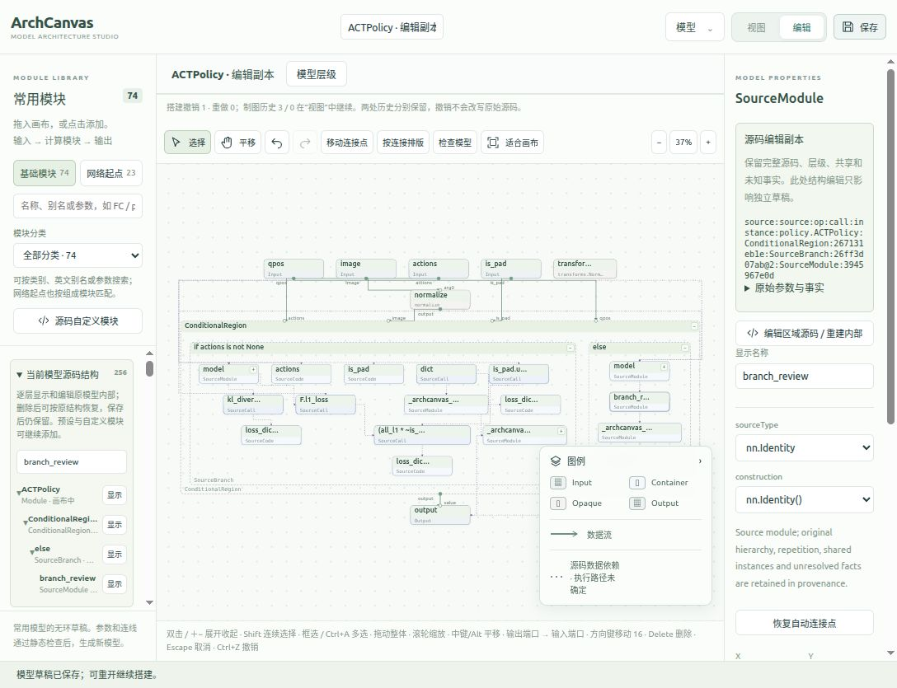

# 源码分支的细粒度编辑、恢复与重建（2026-10-16）

本次修复 ACTPolicy 在预览中有内部结构、进入编辑后却只剩空 if/else 卡片的问题。修改位于正式开发目录及其源码树 Skill；已安装的 beta.12 没有重新发布或安装。独立验收指标见 [acceptance.json](evidence/nested-source-editing-20261016/acceptance.json)。

## 行为变化

- 编辑前沿自动展开分支、条件及循环等源码作用域，显示直接内部结构；大型模块仍可按需逐层展开，避免一次性创建全部检查卡片。旧草稿进入编辑时也会补齐分支内部。
- “当前模型源码结构”列出当前模型的源码层级，可以定位、展开以及恢复已删除区域；恢复不依赖撤销历史，也不需要用预设模块猜测原结构。
- 删除源码区域时保留原始事实、已编辑快照、隐藏子项及其所属用户模块。保存、重开或展开其他区域不会使已删除子项重新出现；恢复所属区域后重新取得其内部结构。
- 整个源码模型删空后仍保留恢复来源。恢复保留局部名称、位置和未冲突连接，独立删除的连接及已有新连接不会被无条件覆盖。
- 对需要重建 if/else、循环或未知模块实现的情况，增加“编辑区域源码 / 重建内部”。所选卡片定位到完整的冻结 Python 文件；已支持的待生成草稿修改先写入独立源码，再进行文件编辑。语法检查和独立重分析通过后，可创建新的工作副本并重新进入预览、编辑。
- 旧草稿展开后重新容纳内部结构，并移动受影响的下游模块，避免原来小卡片的尺寸和位置使新增内部结构重叠或越出容器。

源码文件编辑与视觉连线合同独立。检查区域中的语法关联线不被转换成张量计算；尚不能生成的草稿改动会明确阻止打开源码编辑，用户可以先恢复或撤销这些改动。源码编辑产生新文档，原草稿及其编辑历史保留。

## ACT 独立验收

原始模型目录 `/home/fzg/PycharmProjects/ArchCanvas/Constraint relationship of architecture diagram/act` 保持只读。74 个文件的路径、SHA256、大小和纳秒修改时间与此前基线完全一致。增删改仅在 `/tmp/archcanvas-nested-editor-20261016/` 的独立副本中进行，没有新增专用 ACT 适配器或规则，也没有导入、实例化或执行模型。

| 场景 | 结果 |
| --- | --- |
| 原始 ACTPolicy 编辑前沿 | 247 个源码事实投影为 25 张编辑卡片；if 的 12 个、else 的 2 个直接子项全部可见 |
| 已生成 ACTPolicy 编辑前沿 | 255 个源码事实投影为 27 张卡片；if 的 13 个、else 的 3 个直接子项全部可见 |
| 删除分支与撤销 | 删除所属子项，撤销后拓扑、名称和坐标准确恢复；原预览文档不变 |
| 保存后恢复分支 | 删除经过重投影仍然有效；恢复取得全部直接子项及此前局部编辑，生成资格恢复，原源码字节一致 |
| 从未展开的旧草稿分支 | 原 13 卡片草稿可恢复分支的 12 个直接子项，保留新增 Identity 与 ReviewIdentity |
| 折叠模型里的用户子模块 | 删除所属模型后，隐藏子模块不会在其他区域展开时复活；恢复模型后可恢复该子模块 |
| 整个模型删空再恢复 | 保存后仍有完整模型恢复入口，恢复为 25 节点、6 条张量连接，生成检查通过 |
| 旧草稿布局迁移 | 13→27 张卡片，8 条连接保留；独立卡片边界检查为 0 个非祖先重叠、0 个越出所属容器 |
| 完整源码重建分支 | 从旧草稿读取的源码保留 Identity、ReviewIdentity，再新增 `review_branch = nn.Identity()` 及 inference 分支调用；其他 20 文件不变，独立重分析一致 |
| 重建后的两种显示 | 正式编辑为 28 张卡片，if 的 13 个、else 的 4 个直接子项全部可见；递归预览显示 `review_branch · nn.Identity`，绑定真实调用位置 |

独立投影样本耗时约 58–82 ms。源码恢复的整体验证还包括后端重分析、检查及生成，不能将该耗时当作浏览器拖动或展开延迟。验收 JSON 分别记录了测量范围，没有据此声明任意规模模型的性能保证。

真实浏览器已在 `8897` 完成旧缓存升级、深层展开/收起、分支删除后保存/重开/恢复、分支内部单个 `F.l1_loss` 删除/恢复。旧草稿最终保留 27 模块、8 条连接；深层展开到 84 模块再收回后，Identity 与 ReviewIdentity 回到 y=1044/1172，没有累积位移或大空白，当前界面没有重叠或阻塞布线提示。

源码弹窗中给 `else` 新增 `branch_review = nn.Identity()` 的实际界面流程也已通过：语法与独立重分析 → 创建新工作副本 → 递归预览显示新模块 → 编辑模式显示 28 模块 → 删除新模块并撤销恢复 → 保存、重开。待生成的 Identity 和 ReviewIdentity 仍包含在源码中。原草稿与新文档分别保留。

[原草稿](http://127.0.0.1:8897/?documentId=canvas-architecture-policy.ACTPolicy-8d930aa31b37-bdce645d) · [重建的新模型](http://127.0.0.1:8897/?documentId=canvas-architecture-policy.ACTPolicy-4c782cbfbe58-5ae609ca)

源码嵌套展开还修复了缓存误判：已物化的连接编辑及由当前替换充分解释的原连接删除记录，不再被当作隐藏结构阻断生成。实际 13、27、84 卡片草稿的生成结果摘要完全一致；真正隐藏或未知的编辑继续保留拒绝检查。

前端全量回归为 803 项：802 通过、1 项跳过、0 失败。最终几何和缓存修复后再运行相关前端 30 项全部通过、后端 50 项中 49 通过/1 项 HTTP 沙箱跳过；该 HTTP 用例已另外在允许 loopback 的环境通过。各组存在重叠，不能相加。最终生产构建、TypeScript 和差异检查通过；构建仍提示已有主脚本大于 500 kB。日志与实现哈希见同目录验收 JSON。

## 支持边界

本次保证可解析源码结构在编辑中可访问，并提供有来源的删除、恢复和显式源码重建路径，不能据此声明任意模型、任意图形重接都能自动生成正确实现。

重建后的 ACT 递归预览仍报告 3 个不透明边界和 3 个截断检查区域。外部实现、动态配置及运行时层级可能不完整。图形结构生成继续要求现有的独立源码锚点合同；未知分支的任意增删重接应使用明确的源码文件编辑流程，而不是将检查箭头当作张量语义。

源码编译与静态重分析不验证 shape、dtype、实际运行分支或数值等价。完整文件编辑也可能修改所选区域以外的同文件代码，界面因此提供完整文件及原始源码供核对。用户原始工程不被写回；写回仍属于独立的源码审查事务。
