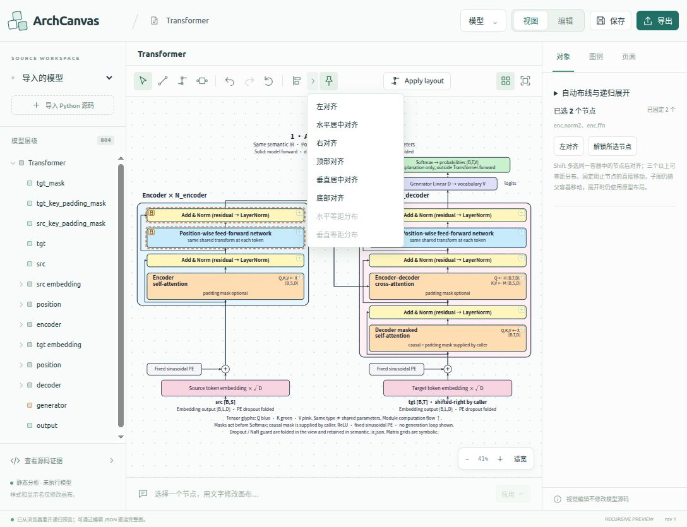

# 原型选区的排列与固定

2026-10-14，修复迁入原型后工具栏“左对齐”和“固定 / 解锁”仍依赖旧 Studio 场景与正式源码映射的问题。工具现在读取 Summary_Merge 的实际可见选区、坐标和展示状态，通过原型引擎执行并同步回正式面板。有些原型图元没有单独的正式源码节点，也可以使用这些视觉操作；这不会为它们增加源码编辑权限。

按住 Shift 点击节点可多选。上方左对齐按钮用于两个以上同级节点，旁边菜单提供左、水平居中、右、顶部、垂直居中和底部对齐，以及水平、垂直等距分布。分布需要三个以上同级节点，保留两端位置并使节点之间的空隙相等。右侧“画布选区”显示实际选中对象与固定数量。

固定按钮对当前选区设置直接移动锁定，全部固定时变为解锁。固定节点仍可选中，显示锁标记并可作为对齐基准；多个固定基准不一致时拒绝操作，等距分布前需解锁。这里固定的是节点的直接移动：子节点仍随父容器移动，递归展开仍使用原型布局。工具、面板和提示都明确这一范围。锁标记属于编辑辅助信息，SVG 导出不包含它。

每次排列经过原型的容器、障碍物、路由及源码绑定校验，不能实现的排列保留原图和历史，并显示原因。父子混选、跨容器排列、语义分支连接点、目标超出画布、节点重叠和路由不合法均被拒绝。成功的一批操作只增加一次原型撤销记录；已对齐或已固定的重复操作不增加历史。视觉排列与固定保存在 IndexedDB 和编辑 JSON，原有正式源码映射及模型编辑流程继续保留。

上方新增 Apply layout，调用原型既有的 Worker 布线流程和右侧抽屉中的范围、策略、端口及距离参数。嵌入模式隐藏抽屉中的重复按钮，独立页面保留。工具栏的“论文 · 彩色 / 黑白”预设下拉项已移除。

验证记录位于 [preview-arrangement-20261014](evidence/preview-arrangement-20261014/)。本轮前端专项回归 54 项通过，TypeScript 检查与生产构建通过。真实浏览器检查 22 项全部通过、无页面错误，覆盖全部八种排列方式、固定与解锁、拒绝路径、撤销恢复、保存、编辑 JSON 恢复、未映射原型图元和 SVG 辅助标记过滤。最终主 bundle 为 `index-65EtP5ZY.js`；9 个集成资源的清单、正式 public 与 dist 字节一致。原型目录未修改。

- [实际浏览器报告](evidence/preview-arrangement-20261014/report.json)
- [引擎桥接回归](evidence/preview-arrangement-20261014/bridge-smoke.json)
- [集成资产完整性](evidence/preview-arrangement-20261014/integration-integrity.json)
- [54 项专项回归](evidence/preview-arrangement-20261014/frontend-targeted.log)
- [构建日志](evidence/preview-arrangement-20261014/frontend-build.log)

