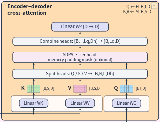

# 局部展开、连线与交互性能修复

Transformer 局部展开曾将 Memory→K/V 的共享分支错误地移到容器左侧；折叠模块生成的共享干线与边界通道使用了不同的长度；多层容器的残差线缺少经过已登记接口的正交候选路线。这些问题会产生绕行、回折和贴框连线，也使路由器反复搜索。

现在 Memory 的共享水平干线位于 K/V 投影下方，箭头仍从已登记的底部端口进入。混合深度的容器预留内侧通道，Q 和残差线共用一致的分叉几何。经过多个容器接口的候选路径补齐正交转角，并接受完整的源码绑定、节点、障碍、端口、分叉和边界通道校验。原始源码和连接语义不变。

展开事务的构图、布线和校验统一在 Worker 内完成。成功后一次提交图和撤销历史，主线程复用校验结果；失败保留原图，重复请求保留撤销和重做栈。无 Worker 时使用同一任务实现。Studio 同步完成后的几何与展开状态，不再用旧布局引擎重新执行展开，也不生成未显示的旧 SVG 场景。

路由搜索使用 Manhattan 下界的 A*，保留原有非负转折、交叉和重叠代价；正交障碍检测使用与原 Liang–Barsky 等价的快速裁剪。独立裁剪对照及 Dijkstra 最优代价对照覆盖数值边界、障碍、固定端口、交叉代价与途经点。

递归 presentationVersion 升级为 11。旧缓存下次加载时重建路径，保留展开选择、手动偏移、文字锚点和视觉草稿。

验证记录位于 `docs/evidence/preview-expansion-20261014/`。`baseline` 和 `baseline-mixed` 保存旧构建的截图和实际交互耗时；早期 `final` / `final-v2` 的失败也保留，以记录严格通道检查发现的问题。`final-v3/report.json` 的 20 项检查通过，覆盖 16 次真实展开与收起，最终 83 个节点、85 条边。所有步骤的源码摘要恒定、非法连接为 0、边框通道 contacts/constrained 为 0，Memory 的 K/V 消费者均保持底部入端。原生工具栏撤销/重做恢复准确几何，重复展开请求保留重做栈。

同一浏览器脚本、同机、无引擎测试并发时的比较如下。`visibleMs` 是旧新共同的测量口径，包含脚本准备诊断快照的耗时；新版另记录实际点击到界面提交的 `actionMs`，不可与旧版 `visibleMs` 直接比较。

| 逐步展开 | 旧版 visibleMs | 修复后 visibleMs | 修复后 actionMs |
| --- | ---: | ---: | ---: |
| Decoder Cross-Attention | 3972 | 965 | 491 |
| Decoder FFN | 5096 | 1076 | 546 |
| Decoder Norm2 | 7004 | 1297 | 691 |
| Decoder Self-Attention | 9247 | 1734 | 1064 |

新版完整序列的实际动作耗时为 397–3269ms。已缓存模块的重新打开约 0.4 秒；最深组合初次展开或收起仍需约 2–3 秒的后台路由。主线程 SVG 渲染为 2–23ms。测试中的显式诊断快照也会产生长任务，因此报告保留其归因和时间，不将全部长任务直接算作用户手势卡顿。



正式引擎回归只加载本项目 vendored 引擎。父侧快照投影、Worker/fallback 一致性、事务拒绝、旧缓存恢复、草稿语义保护和最优路由代价分别有独立回归记录。后续并发编辑检查与源码互通检查记录绑定最终构建字节；它们在引擎回归并行时执行，耗时不用于上述比较。

可复现命令：

```bash
cd studio
node --experimental-strip-types --test --test-isolation=none tests/previewFrontierTask.test.ts tests/previewFrontierRoutes.test.ts tests/previewRouterSearch.test.ts tests/previewDraftConstraints.test.ts tests/previewSnapshotProjection.test.ts
node scripts/test-preview-expansion.mjs --base http://127.0.0.1:8891 --phase final
python3 scripts/test-preview-engine-regression.py
```

父侧 CPU 投影测量及其适用边界见 `preview-expansion-parent-performance.md`。浏览器耗时包含本机的前后台消息、路由和界面提交，不能作为所有模型的固定时延保证。
