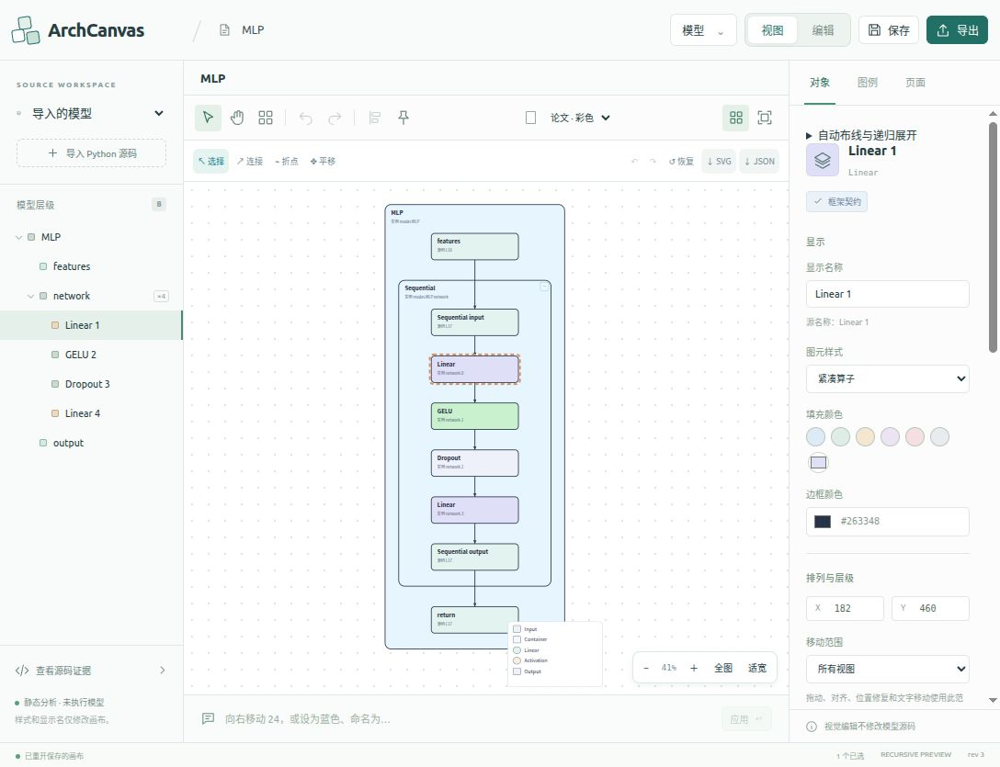

# Summary_Merge 预览迁入正式 Studio

2026-10-14，按用户要求将独立原型 `prototype/Summary_Merge` 的预览技术复制到正式项目。中心画布使用递归图、源码适配、连接编辑与路由引擎；正式 Studio 的顶部工具、左侧模型层级、右侧对象/图例/页面面板和基于图例的模型编辑继续使用。完整案例目录放在“模型 → 示例与模块库”，自动布线入口在右侧折叠菜单中。

这次来源是 `Summary_Merge`，不同于此前拒绝使用的 `ArchCanvas_Model Architecture Studio_Temp`。前端资源、模型材料和证据在正式项目内独立保存，运行时不回退到任一原型服务。

## 启动和文件位置

Python 3.11+，前端建议 Node 24+。已有依赖时：

```bash
cd ~/PycharmProjects/ArchCanvas/ArchCanvas_Model_Architecture_Studio/studio
npm run build
cd ..
PYTHONPATH=src .venv/bin/python -B -m archcanvas_cli capabilities
PYTHONPATH=src .venv/bin/python -B -m archcanvas_cli serve --host 127.0.0.1 --port 8765
```

打开 [Studio](http://127.0.0.1:8765)。一个正式服务同时提供页面、预览解析、编辑、文档和导出 API，不需要启动 `source_adapter/serve.py`。首次安装依赖仍按总 README 的 `npm ci` 和 `requirements.lock` 说明执行。PDF/PNG 需要项目解释器中的 CairoSVG 与系统 Cairo；缺少时 SVG 可用，其他格式由 capabilities 明确返回不可用。

| 正式路径 | 用途 |
| --- | --- |
| `studio/public/preview/yworks_edge_router_lab` | 递归前端、Worker、路由、交互及同源 Studio 桥 |
| `studio/public/preview/data` | 案例目录和源码索引 |
| `studio/public/preview/snapshots`、`verification` | 原始模型材料、离线资源及原型历史证据 |
| `src/archcanvas_preview` | 有界 AST 解析器及随 Python 包分发的 registry |
| `studio/src/previewInterop.ts` | 正式编辑与预览之间的源码身份、证据和视觉映射 |
| `studio/public/preview/vendor-manifest.json` | 复制时的逐文件来源、大小、SHA256 清单 |

复制基线为 7,355 个文件、519,531,592 bytes，约 520 MB；该数字来自逐文件 manifest，不使用忽略隐藏/二进制文件的搜索工具计数；最终拷贝完整性另见 [vendor-integrity.json](evidence/preview-migration-20261014/vendor-integrity.json)。登记 115 个当前案例、115 个历史案例和 666 个视图，其中 665 个视图有图 JSON。大量快照用于完整离线案例、源码与证据查看，不是运行时 Python 依赖。Vite build 将这些静态资产复制到 `studio/dist/preview`。发布包因此使用 768 MiB、20,000 文件的显式上限。开发用 `studio/scripts/vendor-summary-preview.py` 可以刷新复制材料，正式启动不执行这个脚本。

## 编辑与预览互通

同一组相对路径和 Python 文本分别进入两个明确的契约：

| 用途 | 契约与来源 |
| --- | --- |
| 递归预览 | `summary-source-adapter/1` 包与 `summary-source-ir/1`，由 `archcanvas_preview` 产生 |
| 正式模型编辑与受审查源码变更 | Architecture schemaVersion 1、CanvasDocument、AuthoredDraft，继续使用 `archcanvas_python` 和现有 authoring/transaction 流程 |

两套 manifest 的字段及 IR 不同，因此预览的 `sourceSha256` / `irSha256` 不能当作正式 `sourceDigest` / `irDigest`。桥接用入口、精确源码字节、文件/行证据和实例身份建立对应。切换案例时废弃在途的旧解析，避免上一模型响应写回当前面板；没有对应证据的图元不猜测新的源码绑定。

已有正式模型可进入递归预览；选择源码可映射图元后，可继续使用对象属性、显示名、颜色、图例、说明、页面、布局等面板。进入“编辑”时，从当前源码重新建立正式 Architecture，再使用现有图例/模块搭建与生成流程。生成新源码后重新解析得到新预览，源码变化不通过几何距离推断。

部分旧教学图、路由实验、外部源码或 formal parser 不支持的实现仍可预览，并使用标记为 `preview-only`、证据为 opaque 的面板投影。该投影不赋予语义编辑能力；源码不可取得或没有正式绑定时，不能提交参数或结构写回。原型的既有模型案例也不表示任意新实现都能被完整解析。

新建、重接和删除预览连接记录为视觉草稿操作，保留来源证据；它们不会自动生成模型、改参数或写回源码。现有受支持语义操作继续经过正式 managed-copy、独立检查、具体审查与 guarded commit；不能将预览箭头当作已执行模型关系。

## 解析范围与接口

解析器只用 Python 标准库 AST 读取提供的文本，不 import、不实例化、不执行模型。支持范围保留原型契约：本地直接 `nn.Module`、跨文件相对导入、直接模块构造、Sequential、别名共享实例、参数签名绑定、静态返回槽位、常见操作和源码值依赖。动态分支/循环、状态和原位修改、外部 helper、复杂继承或未登记调用保留 opaque 区域，不推断运行分支、shape、dtype 或广播规则。

上限保持 80 文件、2 MB 源码、480 节点、3,600 边和深度 10。这里不接入 FX、`torch.export`、ONNX，也不把预览 IR 反向生成为模型。

| POST 接口 | 输入和行为 |
| --- | --- |
| `/api/preview/analyze` | `{files: {relativePath: text}, entry?, config?}` → 原型兼容预览包 |
| `/api/source-adapter/analyze` | 上述分析接口的兼容别名 |
| `/api/preview/edit-source` | `{files, entry}` → 从临时有界源码副本生成正式 Architecture，供原编辑流程注册 |
| `/api/projects/{projectId}/preview` | 从已注册工作副本重新解析；可带 `config`、`baseSourceDigest`、`baseIrDigest`，旧版本返回 409；包附正式 `studioBinding` |
| `/api/preview/exports` | `{svg, format, dpi, widthMm, binding}` → SVG/PDF/PNG 工件及收据，绑定当前预览 SVG 摘要 |

所有接口沿用正式服务 loopback、Host/Origin 检查。上传文本分析不需要 session token；编辑桥、managed project 和导出需要当前 `X-ArchCanvas-Session`。接口不接受服务器源码目录、解释器或任意文件 URL。

预览导出克隆当前图，经过既有 publication SVG 受限词汇验证并按请求宽度保持 viewBox/纵横比。脚本、HTML、外部图片、CSS 资源 URL、外部 marker、DTD 和事件属性不被接受；不启动浏览器或执行模型转换。收据包含 `inputSvgDigest`、`previewSvgDigest` 和输出摘要；来源身份标记为 `browser-declared-preview-binding`、`sourceBindingVerified: false`，表示浏览器声明，不伪装成服务器已重新验证的 IR。

## 保存与恢复

递归展开、局部布局、手动路由、连接草稿及导入包由预览引擎保存在浏览器 IndexedDB；相关偏好保存在 localStorage。正式 CanvasDocument、managed source、authoring drafts、事务和导出仍保存在正式服务状态目录。`serve --data-dir` 指定完整状态根，默认是正式工程 `.archcanvas`。

顶部保存会先请求子预览保存，随后获取并同步 snapshot，再冻结正式文档与历史并提交正式保存；两种存储不是同一数据库或跨存储原子事务，失败时需要分别核对提示。浏览器数据按 origin 隔离：换端口、清理浏览器数据或换浏览器后，服务端 CanvasDocument 不等于包含所有预览路由细节的备份。迁移复杂预览状态时使用“页面 → 下载画布文档”生成的编辑 JSON，并通过“模型 → 导入源码目录 / 适配包”恢复。已保存正式文档的可映射显示名、样式、图例、说明和页面在加载时送入新预览；独有的递归几何、草稿连接和路由仍以预览编辑 JSON/IndexedDB 为准。

## 本次执行的验证

本次重新执行了 20 个相关正式后端套件，150 项测试通过、无跳过，覆盖源码泛化、多文件桥接、authoring、来源保护、HTTP/CAS、managed-copy 审查提交、预览重新解析和 SVG/PDF/PNG 导出。另有 4 项 archive 预算与清单测试通过，验证 7,500 资源、精确容量边界、超大成员拒绝，以及迁移文档/证据被纳入新包且不改变历史包必需清单。命令见下方；摘要见 [preview-migration-validation.json](preview-migration-validation.json)，逐测试输出保存在[后端回归日志](evidence/preview-migration-20261014/backend-regression.log)。

正式目录中复制的路由、图引擎、递归展开与交互模式又执行了 4 个完整测试文件，全部通过，总耗时 413.703 秒。原测试定义共 67 项；此环境 Node 隔离运行器只汇报 4 个文件级结果，因此日志中的 tests=4 与源码定义数分开记录。测试在临时 CommonJS harness 中执行，实际 engine、案例和 snapshots 全来自正式 `studio/public/preview`，不使用原型运行时；覆盖逐级展开/收起、局部布局恢复、来源破坏拒绝、Memory/fork 关系、全展开节点移动、容器边界和双交互模式。实际输出见[核心引擎日志](evidence/preview-migration-20261014/engine-regression.log)，源码/运行时摘要与 fixture remap 见[核心引擎报告](evidence/preview-migration-20261014/engine-regression.json)。

上述 4 套核心回归后，`recursive-graph.js` 又修复了视觉草稿来源检查和展开重建。修改前 SHA 保存在核心报告；最终文件另有 6 项正式草稿约束回归全部通过，覆盖伪造 binding/projection/id、丢失 receipt、删除审计组合绕过、合法删除/重接、新草稿以及展开/全展开与 JSON 恢复，见[最终草稿日志](evidence/preview-migration-20261014/draft-constraints-final.log)。没有将此前 67 项结果归属于修改后的递归文件。

收尾兼容门禁修改前的完整 `npm test` 共 620 项，619 通过、0 失败、1 项因当前 sandbox 无法启动 Chromium 而跳过，耗时 256.485 秒，完整输出见[前端回归日志](evidence/preview-migration-20261014/frontend-regression.log)。集成负责人另外通过真实浏览器完成 PDF/PNG 导出，以及将参数改为 `p=0.2` 后“编辑 → 预览 → 保存重开 → 返回编辑”的交互检查；这属于独立浏览器操作记录，不把被跳过的自动测试记为通过。 实际 UI 检查记录及导出收据见 [ui-verification.json](evidence/preview-migration-20261014/ui-verification.json)。

收尾兼容门禁、previewCase 恢复与 snapshot 保存修改后，相关前端套件再次执行 61 项，61 通过、0 失败、0 跳过，见[最终专项日志](evidence/preview-migration-20261014/frontend-final-targeted.log)。最终 `npm run build` 成功，构建日志见[最终构建日志](evidence/preview-migration-20261014/frontend-final-build.log)，主 bundle 为 `index-C4t4SUpH.js`；HTTP 资产报告已绑定该构建及相同 dist/public vendor manifest，摘要记录入口、bundle 和 manifest 的 SHA256。

正式源码副本在 `/tmp` 以 `-I -S`、无 site-packages 执行，7 个 Python 包都解析到独立副本；离线 wheel 构建确认 `archcanvas_preview` 和 `registry.json` 随包发布。正式 `.venv` 下实际验证 SVG、PDF 和 PNG，系统 `python3` 缺少 CairoSVG 的情况不计为 PDF/PNG 成功。

对当时运行的 [127.0.0.1:8891](http://127.0.0.1:8891) 正式服务，逐项读取 2,281 个静态资源，共 160,314,932 bytes，全部 HTTP 200 且响应内容与正式 `dist` 完全一致，缺失或 SPA fallback 伪匹配为 0。逐资源路径、响应类型、大小和 SHA256 保存在 [HTTP 资产报告](evidence/preview-migration-20261014/http-assets.json)。范围包含目录视图、IR、sourceDocs、源码索引资源、前端引擎/Worker/CSS 和主 bundle；它不表示逐像素审核了全部案例。后续构建字节变化需要重新核对对应资产。

```bash
PYTHONPATH=src:tests .venv/bin/python -B -m unittest -v \
  test_authoring test_authoring_catalog_expanded test_authoring_diagnostics_http \
  test_authoring_group_generation test_authoring_http_independent test_canvas_persistence \
  test_custom_modules_http test_large_source_workflow test_output_paths test_publication_export \
  test_rebind_analysis test_residual_roles test_runtime_server test_source_authoring_bridge \
  test_source_dependencies test_source_generality test_source_numeric_roundtrip \
  test_source_region_structure test_stage2_http test_preview_backend
PYTHONPATH=src:tests .venv/bin/python -B -m unittest -v test_preview_bundle_budgets
```

原型旧报告中的 328 视图、5,538 连接显示检查和 4,011 语义破坏负例在本次迁移中没有重新执行，不计为正式新构建的验证结果。本页的测试不证明所有模型视觉等价、任意 Python 完整恢复、图到源码等价、全局路由最优、真实模型运行、外部 checkpoint 兼容或真人出版审看；后续前端构建字节变化由最终资产报告与集成记录绑定。

最终 focus 修复的来源与覆盖边界见 [focus-final-change.json](evidence/preview-migration-20261014/focus-final-change.json)。正式浏览器另外验证了 6 项草稿连接属性与 undo/redo，以及 3 项无源码路由案例保存/整页重载恢复，分别见[草稿连接检查](evidence/preview-migration-20261014/formal-draft-edge-smoke.json)和[路由状态恢复检查](evidence/preview-migration-20261014/formal-routing-persist-smoke.json)；最终 `index-C4t4SUpH.js` 的正式服务桥接检查 18 项通过，见 [preview-bridge-final-dist.json](evidence/preview-migration-20261014/preview-bridge-final-dist.json)，通用报告为 [preview-bridge-smoke.json](evidence/preview-migration-20261014/preview-bridge-smoke.json)。

最终 Studio 界面快照：


