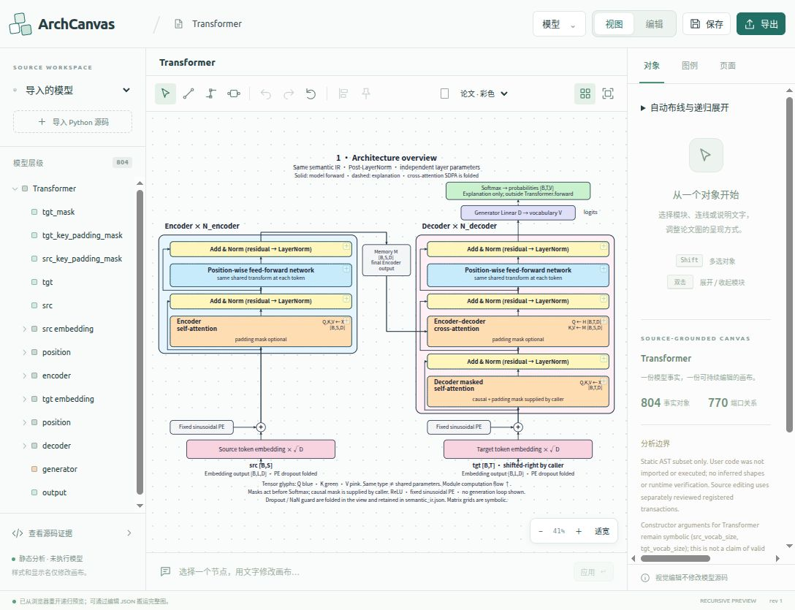

# 预览工具整合

2026-10-14，在已迁入的 Summary_Merge 预览上合并重复入口。所有预览交互、几何、递归展开、连接编辑、路由和视觉历史继续由正式项目内复制的 Summary_Merge 引擎处理。Studio 提供原有顶部、左侧、右侧面板及统一入口，原型目录未修改。

| 功能 | 当前入口与行为 |
| --- | --- |
| 选择、连接、折点 | 画布上方同一工具栏；V / C / B 切换，父页面与画布内焦点都可使用 |
| 连接点 | “显示连接点”；原型的端口创建连接及 S / T 端点重接继续使用 |
| 撤销、重做 | 上方工具栏；Ctrl/Cmd+Z、Ctrl/Cmd+Shift+Z、Ctrl/Cmd+Y 使用原型视觉历史 |
| 恢复初始视图 | 上方工具栏，调用原型 reset；本次恢复可撤销 |
| Apply layout | 上方工具栏，使用布线抽屉当前的范围、策略和路由参数；保留 Ctrl/Cmd+Enter |
| 对齐与分布 | Shift 多选同级节点后使用左对齐，旁边的展开菜单提供六种对齐和两种等距分布；读取原型画布的实际选区和坐标 |
| 固定 / 解锁 | 对选中的原型节点固定直接移动，按钮与右侧选区显示实际固定状态；混合选区点击固定会固定整个选区 |
| 平移 | 按住鼠标滚轮（中键）拖动；可从节点、连线、文字或空白处开始，只改变视角 |
| 缩放与适配 | 滚轮缩放；画布保留 − / ＋ / 适宽；上方保留“适合画布”及 F |
| 保存 | 右上“保存”，画布内 Ctrl/Cmd+S 转入同一保存流程 |
| 导出 | 右上“导出”，统一 SVG / PDF / PNG / 编辑 JSON；导入模型另有源码包 |
| 导入 | “导入 Python 源码”统一单文件、目录、编辑 JSON 与适配包入口 |
| 原型案例库 | “模型 → 示例与模块库”，保持折叠菜单中的次级入口 |
| 布线、递归与辅助显示 | 右侧“自动布线与递归展开”；“画布辅助显示”保留上次路径和安全边界 |

嵌入画布的原型工具栏及重复保存、导出、全图、Apply layout 按钮隐藏。上方的“论文 · 彩色 / 黑白”下拉项已移除。点阵网格仅控制画布显示；布线抽屉的候选网格仍单独控制路由求解。高级连接操作、容器接口、IR 和来源证据保留各自用途。

编辑 JSON 冻结完整预览 snapshot，保留递归状态、视觉布局、路由、草稿连接、样式及已有适配包；使用统一导入入口恢复。源码包下载原始适配包中的源码、IR 和证据，视觉草稿连接继续与受审查源码编辑分离。保存与正式模型编辑互通的边界沿用 [迁移说明](preview-migration.md)。

对齐与固定接入修复记录见 [排列与固定功能](preview-arrangement.md)。下方结果记录工具栏首次合并时的构建；后续新增功能使用独立报告。

本次相关前端回归 54 项全部通过，构建成功；最终 dist 桥接浏览器检查 22 项全部通过，父页面浏览器检查 16 项全部通过，两者均无页面错误。父页面回归实际验证连接与折点操作、四类位置中键平移、撤销与恢复、Ctrl+S 正式保存、五种导出入口、源码包、编辑 JSON 下载并重导入，以及真实 SVG。打包预算回归 4 项通过；全部预览资源与 dist 逐字节一致。最终主 bundle 为 `index-u5A-QVy8.js`，本机服务响应与当前 dist 一致。首次迁移报告未被替换，也不用于证明当前修改后的构建。

| 验证材料 | 内容 |
| --- | --- |
| [前端专项日志](evidence/preview-toolbar-20261014/frontend-targeted.log) | 54 项前端专项回归 |
| [构建日志](evidence/preview-toolbar-20261014/frontend-build.log) | TypeScript 与生产构建 |
| [引擎桥接检查](evidence/preview-toolbar-20261014/bridge-dist-smoke.json) | 22 项原型引擎与桥接浏览器验证 |
| [父页面检查](evidence/preview-toolbar-20261014/report.json) | 16 项统一入口的实际浏览器验证 |
| [资源完整性](evidence/preview-toolbar-20261014/vendor-integrity.json) | 7,355 个复制资源与 dist 核对 |
| [最终构建绑定](evidence/preview-toolbar-20261014/final-build-verification.json) | 最终入口、bundle、样式、引擎、manifest 的 HTTP 字节与 SHA256 |
| [打包回归](evidence/preview-toolbar-20261014/bundle-budget.log) | 4 项预算与证据打包回归 |

