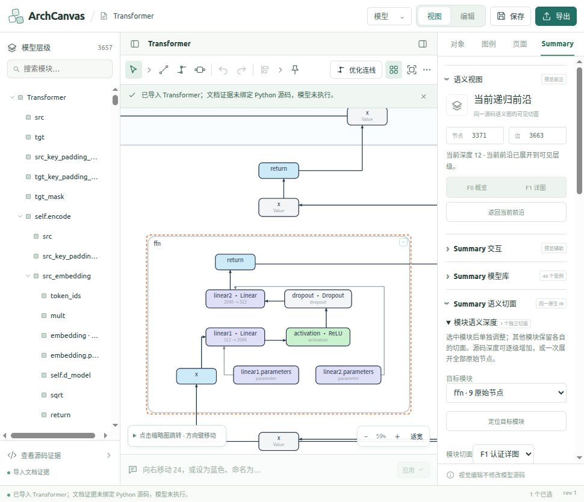
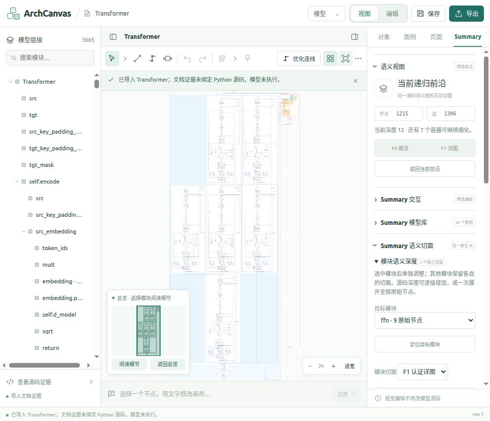

# Summary 模型库：全案例逐级展开、源码归属与视觉回归

结果：**46/46 个案例的最终完整源码/登记原子状态通过，259 张截图中 258 张图投影通过独立图元与绑定核验，另 1 张为正式编辑界面证据。** 静态 Transformer 的 3368 节点混合图与 3371 节点整模型图均无待处理、失败或无效连线。

日期：2026-10-28。对象为正式 Studio 当前的 **43 个原生语义模型 + 3 个登记预览案例**；不把归档快照、旧 benchmark 或路由实验页面计入这 46 个模型。本报告的统计、图库和逐例结果位于文末。

## 验证范围和证据边界

本次测试从 F0、局部 F1、阶段/细节切面、局部源码深度 1 等状态逐步进入原子层，并在有独立同胞模块的模型中混合设置不同模块切面。原生语义审计另覆盖源码深度 0、1、2、3、4、全部及各语义切面，共 **602 组组合**。

“3000+”适用于原始 IR 确实具有该规模的静态 Transformer。其余案例展开到各自真实最大体量，不能通过复制节点凑到 3000。节点数包含真实的容器、参数、值和运算图元，不等同于独立 Python 语句数量。

- 原子归属：所有原始节点与原始依赖各归属一次，无遗漏、重复；可见端点的父容器存在。
- 模块隔离：更改目标模块时，同胞 F0 切面不被全局展开覆盖；更具体的子模块覆盖仍保留。
- 依赖语义：对原始 source/target、端口、操作数及证据绑定核对；可变的路由点不冒充源码语义。
- 源文件：检查 183 条文件/Notebook 证据记录的哈希、AST 与 6380 个节点的源码范围，无发现哈希或范围异常。
- 绘制：从真实 iframe SVG 收集图元 ID、依赖绑定、source/layout 校验标志和无效连线数，再独立重建投影核对。截图与同名 JSON 对应。
- 视觉：检查各案例完整源码图的联系表；另对大图中的 FFN、注意力与混合模块做局部阅读检查。全图缩略图用于确认结构，不能据此声称全部文字都可直接阅读。

**没有重新执行 Python 模型，没有独立从 Python 重生成全部 IR，也没有提交源码事务。** 源文件审计支持位置与文件一致性，不是对全部运算语义重新求值的证明。CPU 案例使用文档内已有观察证据；静态未观察路径仍然未知。导入后的“未绑定可编辑 Python”提示保留，不把显示权限当作源码编辑权限。

## 关键大图和混合切面

| 案例/状态 | 节点 | 依赖 | 完成结果 |
| --- | ---: | ---: | --- |
| 静态 Transformer：Encoder 全源码，Decoder F1 | 1215 | 1306 | source/layout 有效，无无效连线 |
| 静态 Transformer：Encoder、Decoder 都为源码原子 | 3368 | 3660 | 分批完成，待处理 0、失败 0 |
| 静态 Transformer：整个模型源码原子 | 3371 | 3663 | source/layout 有效，无无效连线 |
| CPU 原生 IR：Encoder 原子，Decoder F1 | 235 | 242 | 分批完成 |
| CPU 原生 IR：Encoder 原子，Decoder 源码深度 3 | 264 | 270 | source/layout 有效，无无效连线 |
| CPU 原生 IR：完整源码视图 | 626 | 663 | source/layout 有效，无无效连线 |
| CPU 登记预览：完整登记图 | 306 | 250 | 后台与界面逐步展开均到达完整 306 节点，校验通过 |

CPU 原生 IR 含 1194 个原始节点，其中包含 CPU 观察分支；源码视图的 626 节点不是丢失 568 个源码节点。静态 Transformer 的 3368 与 3371 差异来自根层剩余图元，二者分别以各自投影核对，不混用结论。

大图先使用正式预览引擎在后台执行与 worker 相同的投影/布线任务，保留完整校验，再通过主程序正常的“模型 → 导入 Python 源码 → 工程目录 / 已有文档 → 选择 Summary / 编辑 JSON”入口载入。截图的 `meta.method` 标明该方式。它证明完整投影的绘制和文档恢复，**不表示在浏览器里一次点击就立即完成全部布线**。普通案例与多组中间状态则通过真实面板操作采集。

## 发现的问题和修复

| 问题 | 修复及验证 |
| --- | --- |
| 3000+ 源码大图比例过于狭长，难以浏览 | 调整密集源码布局宽度和层间空隙；保留原始层级与节点身份，使用概览导航和模块阅读定位 |
| 大图尾部连线在预算中反复停滞 | 公平分配重试次序、递增单边预算；重复结构只提供平移候选，仍逐条检查实际端口、所有障碍、边界和占线 |
| 全坐标搜索和非法候选的成本计算过慢 | 候选先检验几何合法性，再计算代价；压缩搜索坐标保留真实障碍及语义边界，失败回退完整坐标，新增绕障回归 |
| WideBranches 物理端口回滚占用另一个已移动槽位 | 回滚前核对同伴占用；保持端点语义不变 |
| CPU 登记图的 Memory K/V 经过嵌套 Decoder 边界时回滚 | 外部 producer 位于消费者框外时，不再把 gate 挤到标题角落；保留消费者共同通道。对相关原始依赖和 gate 顺序增加测试 |
| 登记预览全局 F0/F1 残留局部覆盖，且逐个展开过慢 | 改为单次 preset 转换，清除 moduleCuts/moduleBase/moduleManual，一次生成并校验前沿；历史图对象不被就地修改 |
| 宽容器定位只看到空白角落 | 阅读相机按实际后代叶节点定位；补齐宿主 `studioFocus` 入口遗漏的 `graph.nodes` 参数，并执行真实处理函数的回归测试 |
| 旧截图包含未完成布线或失败后回滚的画面 | 保留诊断来源，最终结果重新采图；不以“有 PNG”或旧节点数作为成功证明。CPU 登记预览刷新加载最新 runtime 后重测，285 节点双模块展开通过 |

这些优化均不得省略源码绑定、端口许可、边界顺序、障碍或全图校验。路由未完成时仍显示待处理，不强制把失败标志改为成功。

## 自省、编辑模式和性能限制

1. 第一轮只比较节点/依赖归属不足以发现空白定位；因此补了真实截图和宿主定位函数测试。
2. 同一页面长时间运行会继续使用加载时的 JavaScript。构建后必须刷新，再重测失败操作；后台通过不能代替最新构建的界面回归。
3. NiN 的首次全源码截图曾有 75 条待处理，CPU 原生混合图曾有 5 条待处理。这些是过程状态，不计为最终通过；后续完成状态另行核验。
4. 登记预览 a 已实际进入正式编辑工作区再返回视图，编辑截图标记为 `authoring-ui`，不错误套用预览 SVG 节点数。没有逐一测试所有模型的每项编辑命令；没有提交参数或结构事务。
5. 图的 source/layout 有效并不意味着没有交叉或达到最终出版排版。千节点全景仍需缩放、缩略图和“定位目标模块”阅读。
6. 22 MB 的大图 JSON 导入也有明显等待，本次浏览器探测曾在导入期间超时，随后确认导入完成；不能把它视为即时打开。3371 节点和 3368 节点状态需要分批布线；后者本次约 32 批才完成。CPU 登记图的局部双模块展开后台测得约四分钟，仍属明显性能限制。界面保留取消入口，不宣称流畅或即时。

## 可重复执行

在正式项目目录中执行：

```bash
node studio/scripts/audit-summary-all-cases.cjs
.venv/bin/python -B scripts/audit_summary_source_evidence.py
node studio/scripts/verify-summary-browser-evidence.cjs
node studio/scripts/prepare-summary-projection.cjs 0216717d966327f4 /tmp/transformer-source.json
cd studio
node --experimental-strip-types --test --test-isolation=none tests/previewViewNavigation.test.ts tests/previewApp.test.ts
node --experimental-strip-types --test --test-isolation=none tests/previewRecursiveLaneRepair.test.ts tests/previewRecursiveSpine.test.ts tests/summaryRegisteredCuts.test.ts
npm run build
```

`prepare-summary-projection.cjs` 第三个参数可传入模块切面数组，例如 Encoder source、Decoder F1；登记案例则传 frontier-task 转换数组。脚本在 60 批后仍未完成会报错，不能把输出诊断 JSON 视为成功。它不启动 Python 模型。

完整文档以 gzip 保存于 [replay](evidence/summary-all-cases-progressive-20261028/replay/)，解压为 JSON 后使用主程序导入。包含静态完整图、双模块原子图、Encoder 原子/Decoder F1 图、CPU 原生完整源码图和 CPU 登记完整图。

## 自动化检查记录

| 检查 | 结果 | 记录 |
| --- | --- | --- |
| 原生语义与同胞隔离 | 43 模型，602 组合通过 | [semantic-audit.json](evidence/summary-all-cases-progressive-20261028/semantic-audit.json) |
| 源文件证据 | 183 记录，6380 范围，无异常 | [source-evidence-audit.json](evidence/summary-all-cases-progressive-20261028/source-evidence-audit.json) |
| 布局/混合表示/导航 | 58/58；后续宿主定位测试另测 | [布局日志](evidence/summary-all-cases-progressive-20261028/summary-final-layout-tests.log) |
| 契约/递归/authoring | 175/175，发生在最后 gate/preset 修复前；相关项另回归 | [契约日志](evidence/summary-all-cases-progressive-20261028/summary-final-contract-tests.log) |
| 最终递归通道与 spine | 21/21 | [递归日志](evidence/summary-all-cases-progressive-20261028/summary-final-recursive-tests.log) |
| CPU 登记 gate 与 preset | 2/2 | [登记日志](evidence/summary-all-cases-progressive-20261028/summary-registered-tests.log) |
| 最终宿主定位与 app | 25/25 | [定位日志](evidence/summary-all-cases-progressive-20261028/summary-final-focus-tests.log) |
| 截图与原始依赖核验 | 258/258 图投影通过；另 1 张编辑模式证据 | [核验记录](evidence/summary-all-cases-progressive-20261028/browser-verification.json) |
| 构建 | TypeScript 与 Vite 通过；存在 bundle 体积提示 | [构建日志](evidence/summary-all-cases-progressive-20261028/summary-final-build.log) |

以上测试组存在重叠，不把各组数量相加作为独立测试总数。当前改动的文件哈希记录在 [implementation-manifest.json](evidence/summary-all-cases-progressive-20261028/implementation-manifest.json)。静态资源两份清单共核对 7399 条，哈希和字节数无不符；`git diff --check` 通过。

<!-- GENERATED-RESULTS -->

## 最终截图索引与逐例结果

本节从截图索引自动汇总：46 个模型，259 张去重截图（包含编辑界面截图）；各模型最终完整原子/源码状态 46/46 个 source/layout 有效且无无效连线。每张截图另有同名 JSON，可追溯图元 ID、原始绑定和模块切面。

[完整截图图库](evidence/summary-all-cases-progressive-20261028/gallery.html) · [浏览器图元核验](evidence/summary-all-cases-progressive-20261028/browser-verification.json) · [原始截图索引](evidence/summary-all-cases-progressive-20261028/browser-index.json)

| 案例 | 最终节点 / 依赖 | 最终图 | 已采语义层级截图 |
| --- | ---: | --- | --- |
| Transformer · 语义架构 | 3371 / 3663 | [通过](evidence/summary-all-cases-progressive-20261028/0216717d966327f4-static-10-source-complete.png) | [static-01-f0](evidence/summary-all-cases-progressive-20261028/0216717d966327f4-static-01-f0.png) · [static-02-encoder-f1](evidence/summary-all-cases-progressive-20261028/0216717d966327f4-static-02-encoder-f1.png) · [static-03-encoder-detailed](evidence/summary-all-cases-progressive-20261028/0216717d966327f4-static-03-encoder-detailed.png) · [static-04-encoder-source-depth1](evidence/summary-all-cases-progressive-20261028/0216717d966327f4-static-04-encoder-source-depth1.png) · [static-05-encoder-source-depth3](evidence/summary-all-cases-progressive-20261028/0216717d966327f4-static-05-encoder-source-depth3.png) · [static-06-encoder-source-depth5](evidence/summary-all-cases-progressive-20261028/0216717d966327f4-static-06-encoder-source-depth5.png) · [static-07-encoder-atoms-decoder-f1](evidence/summary-all-cases-progressive-20261028/0216717d966327f4-static-07-encoder-atoms-decoder-f1.png) · [static-08-decoder-f1-reading](evidence/summary-all-cases-progressive-20261028/0216717d966327f4-static-08-decoder-f1-reading.png) · [static-09-both-atoms](evidence/summary-all-cases-progressive-20261028/0216717d966327f4-static-09-both-atoms.png) · [static-11-ffn-reading](evidence/summary-all-cases-progressive-20261028/0216717d966327f4-static-11-ffn-reading.png) · [static-12-cross-attention-reading](evidence/summary-all-cases-progressive-20261028/0216717d966327f4-static-12-cross-attention-reading.png) |
| MultilayerPerceptron · mlp | 19 / 18 | [通过](evidence/summary-all-cases-progressive-20261028/d6df94c94e8a5888-05-source-all.png) | [01-f0](evidence/summary-all-cases-progressive-20261028/d6df94c94e8a5888-01-f0.png) · [02-module-f1](evidence/summary-all-cases-progressive-20261028/d6df94c94e8a5888-02-module-f1.png) · [03-module-detailed](evidence/summary-all-cases-progressive-20261028/d6df94c94e8a5888-03-module-detailed.png) · [04-module-source-depth1](evidence/summary-all-cases-progressive-20261028/d6df94c94e8a5888-04-module-source-depth1.png) |
| ConvNet · cnn | 28 / 25 | [通过](evidence/summary-all-cases-progressive-20261028/93bf97c492e70b40-05-source-all.png) | [01-f0](evidence/summary-all-cases-progressive-20261028/93bf97c492e70b40-01-f0.png) · [02-module-f1](evidence/summary-all-cases-progressive-20261028/93bf97c492e70b40-02-module-f1.png) · [03-module-detailed](evidence/summary-all-cases-progressive-20261028/93bf97c492e70b40-03-module-detailed.png) · [04-module-source-depth1](evidence/summary-all-cases-progressive-20261028/93bf97c492e70b40-04-module-source-depth1.png) · [04b-sibling-semantic](evidence/summary-all-cases-progressive-20261028/93bf97c492e70b40-04b-sibling-semantic.png) |
| LeNet5 · cnn | 27 / 22 | [通过](evidence/summary-all-cases-progressive-20261028/30f92544f206619a-05-source-all.png) | [01-f0](evidence/summary-all-cases-progressive-20261028/30f92544f206619a-01-f0.png) · [02-module-f1](evidence/summary-all-cases-progressive-20261028/30f92544f206619a-02-module-f1.png) · [03-module-detailed](evidence/summary-all-cases-progressive-20261028/30f92544f206619a-03-module-detailed.png) · [04-module-source-depth1](evidence/summary-all-cases-progressive-20261028/30f92544f206619a-04-module-source-depth1.png) · [04b-sibling-semantic](evidence/summary-all-cases-progressive-20261028/30f92544f206619a-04b-sibling-semantic.png) |
| Autoencoder · autoencoder | 13 / 11 | [通过](evidence/summary-all-cases-progressive-20261028/9b2fc38b37e9a53a-05-source-all.png) | [01-f0](evidence/summary-all-cases-progressive-20261028/9b2fc38b37e9a53a-01-f0.png) · [02-module-f1](evidence/summary-all-cases-progressive-20261028/9b2fc38b37e9a53a-02-module-f1.png) · [03-module-detailed](evidence/summary-all-cases-progressive-20261028/9b2fc38b37e9a53a-03-module-detailed.png) · [04-module-source-depth1](evidence/summary-all-cases-progressive-20261028/9b2fc38b37e9a53a-04-module-source-depth1.png) |
| VariationalAutoencoder · autoencoder | 52 / 55 | [通过](evidence/summary-all-cases-progressive-20261028/09fe4001cbd31998-05-source-all.png) | [01-f0](evidence/summary-all-cases-progressive-20261028/09fe4001cbd31998-01-f0.png) · [02-module-f1](evidence/summary-all-cases-progressive-20261028/09fe4001cbd31998-02-module-f1.png) · [03-module-detailed](evidence/summary-all-cases-progressive-20261028/09fe4001cbd31998-03-module-detailed.png) · [04-module-source-depth1](evidence/summary-all-cases-progressive-20261028/09fe4001cbd31998-04-module-source-depth1.png) · [04b-sibling-semantic](evidence/summary-all-cases-progressive-20261028/09fe4001cbd31998-04b-sibling-semantic.png) |
| RNN · rnn | 22 / 21 | [通过](evidence/summary-all-cases-progressive-20261028/99ebd0c5ae2119d9-05-source-all.png) | [01-f0](evidence/summary-all-cases-progressive-20261028/99ebd0c5ae2119d9-01-f0.png) · [02-module-f1](evidence/summary-all-cases-progressive-20261028/99ebd0c5ae2119d9-02-module-f1.png) · [03-module-detailed](evidence/summary-all-cases-progressive-20261028/99ebd0c5ae2119d9-03-module-detailed.png) · [04-module-source-depth1](evidence/summary-all-cases-progressive-20261028/99ebd0c5ae2119d9-04-module-source-depth1.png) |
| GraphNet · gnn | 21 / 23 | [通过](evidence/summary-all-cases-progressive-20261028/96c15250eeeb4bf1-05-source-all.png) | [01-f0](evidence/summary-all-cases-progressive-20261028/96c15250eeeb4bf1-01-f0.png) · [02-module-f1](evidence/summary-all-cases-progressive-20261028/96c15250eeeb4bf1-02-module-f1.png) · [03-module-detailed](evidence/summary-all-cases-progressive-20261028/96c15250eeeb4bf1-03-module-detailed.png) · [04-module-source-depth1](evidence/summary-all-cases-progressive-20261028/96c15250eeeb4bf1-04-module-source-depth1.png) |
| BranchMLP | 18 / 16 | [通过](evidence/summary-all-cases-progressive-20261028/4ab8c787e32daeac-05-source-all.png) | [01-f0](evidence/summary-all-cases-progressive-20261028/4ab8c787e32daeac-01-f0.png) · [02-module-f1](evidence/summary-all-cases-progressive-20261028/4ab8c787e32daeac-02-module-f1.png) · [03-module-detailed](evidence/summary-all-cases-progressive-20261028/4ab8c787e32daeac-03-module-detailed.png) · [04-module-source-depth1](evidence/summary-all-cases-progressive-20261028/4ab8c787e32daeac-04-module-source-depth1.png) · [04b-sibling-semantic](evidence/summary-all-cases-progressive-20261028/4ab8c787e32daeac-04b-sibling-semantic.png) |
| TinyCNN | 14 / 11 | [通过](evidence/summary-all-cases-progressive-20261028/9e10a966b99ab3ef-05-source-all.png) | [01-f0](evidence/summary-all-cases-progressive-20261028/9e10a966b99ab3ef-01-f0.png) · [02-module-f1](evidence/summary-all-cases-progressive-20261028/9e10a966b99ab3ef-02-module-f1.png) · [03-module-detailed](evidence/summary-all-cases-progressive-20261028/9e10a966b99ab3ef-03-module-detailed.png) · [04-module-source-depth1](evidence/summary-all-cases-progressive-20261028/9e10a966b99ab3ef-04-module-source-depth1.png) |
| ReusedRecurrent | 13 / 12 | [通过](evidence/summary-all-cases-progressive-20261028/61b219f6938bacfb-05-source-all.png) | [01-f0](evidence/summary-all-cases-progressive-20261028/61b219f6938bacfb-01-f0.png) · [02-module-f1](evidence/summary-all-cases-progressive-20261028/61b219f6938bacfb-02-module-f1.png) · [03-module-detailed](evidence/summary-all-cases-progressive-20261028/61b219f6938bacfb-03-module-detailed.png) · [04-module-source-depth1](evidence/summary-all-cases-progressive-20261028/61b219f6938bacfb-04-module-source-depth1.png) |
| ConvVariationalAutoencoder · corpus ae-conv-var | 83 / 80 | [通过](evidence/summary-all-cases-progressive-20261028/corpus-7f9c1f7f1c83-05-source-all.png) | [01-f0](evidence/summary-all-cases-progressive-20261028/corpus-7f9c1f7f1c83-01-f0.png) · [02-module-f1](evidence/summary-all-cases-progressive-20261028/corpus-7f9c1f7f1c83-02-module-f1.png) · [03-module-detailed](evidence/summary-all-cases-progressive-20261028/corpus-7f9c1f7f1c83-03-module-detailed.png) · [04-module-source-depth1](evidence/summary-all-cases-progressive-20261028/corpus-7f9c1f7f1c83-04-module-source-depth1.png) · [04b-sibling-semantic](evidence/summary-all-cases-progressive-20261028/corpus-7f9c1f7f1c83-04b-sibling-semantic.png) |
| VGG16 · corpus cnn-vgg16 | 76 / 57 | [通过](evidence/summary-all-cases-progressive-20261028/corpus-55b90c84cbd8-05-source-all.png) | [01-f0](evidence/summary-all-cases-progressive-20261028/corpus-55b90c84cbd8-01-f0.png) · [02-module-f1](evidence/summary-all-cases-progressive-20261028/corpus-55b90c84cbd8-02-module-f1.png) · [03-module-detailed](evidence/summary-all-cases-progressive-20261028/corpus-55b90c84cbd8-03-module-detailed.png) · [04-module-source-depth1](evidence/summary-all-cases-progressive-20261028/corpus-55b90c84cbd8-04-module-source-depth1.png) · [04b-sibling-semantic](evidence/summary-all-cases-progressive-20261028/corpus-55b90c84cbd8-04b-sibling-semantic.png) |
| NiN · corpus nin-cifar10_filter-response-norm | 245 / 243 | [通过](evidence/summary-all-cases-progressive-20261028/corpus-65e150288325-05-source-all.png) | [01-f0](evidence/summary-all-cases-progressive-20261028/corpus-65e150288325-01-f0.png) · [02-module-f1](evidence/summary-all-cases-progressive-20261028/corpus-65e150288325-02-module-f1.png) · [03-module-detailed](evidence/summary-all-cases-progressive-20261028/corpus-65e150288325-03-module-detailed.png) · [04-module-source-depth1](evidence/summary-all-cases-progressive-20261028/corpus-65e150288325-04-module-source-depth1.png) · [04b-sibling-semantic](evidence/summary-all-cases-progressive-20261028/corpus-65e150288325-04b-sibling-semantic.png) · [05b-routing-pass1](evidence/summary-all-cases-progressive-20261028/corpus-65e150288325-05b-routing-pass1.png) |
| ResidualBlock · corpus resnet-ex-1 | 29 / 29 | [通过](evidence/summary-all-cases-progressive-20261028/corpus-4a94e597a9dc-05-source-all.png) | [01-f0](evidence/summary-all-cases-progressive-20261028/corpus-4a94e597a9dc-01-f0.png) · [02-module-f1](evidence/summary-all-cases-progressive-20261028/corpus-4a94e597a9dc-02-module-f1.png) · [03-module-detailed](evidence/summary-all-cases-progressive-20261028/corpus-4a94e597a9dc-03-module-detailed.png) · [04-module-source-depth1](evidence/summary-all-cases-progressive-20261028/corpus-4a94e597a9dc-04-module-source-depth1.png) |
| ConvNet · corpus resnet-ex-1 | 72 / 73 | [通过](evidence/summary-all-cases-progressive-20261028/corpus-e72c82bf53c9-05-source-all.png) | [01-f0](evidence/summary-all-cases-progressive-20261028/corpus-e72c82bf53c9-01-f0.png) · [02-module-f1](evidence/summary-all-cases-progressive-20261028/corpus-e72c82bf53c9-02-module-f1.png) · [03-module-detailed](evidence/summary-all-cases-progressive-20261028/corpus-e72c82bf53c9-03-module-detailed.png) · [04-module-source-depth1](evidence/summary-all-cases-progressive-20261028/corpus-e72c82bf53c9-04-module-source-depth1.png) · [04b-sibling-semantic](evidence/summary-all-cases-progressive-20261028/corpus-e72c82bf53c9-04b-sibling-semantic.png) |
| GraphNet · corpus gnn-basic-graph-spectral-1 | 36 / 41 | [通过](evidence/summary-all-cases-progressive-20261028/corpus-f0633e55a75e-05-source-all.png) | [01-f0](evidence/summary-all-cases-progressive-20261028/corpus-f0633e55a75e-01-f0.png) · [02-module-f1](evidence/summary-all-cases-progressive-20261028/corpus-f0633e55a75e-02-module-f1.png) · [03-module-detailed](evidence/summary-all-cases-progressive-20261028/corpus-f0633e55a75e-03-module-detailed.png) · [04-module-source-depth1](evidence/summary-all-cases-progressive-20261028/corpus-f0633e55a75e-04-module-source-depth1.png) |
| RNN · corpus rnn_lstm_bi_imdb | 22 / 21 | [通过](evidence/summary-all-cases-progressive-20261028/corpus-cf50d24e3da4-05-source-all.png) | [01-f0](evidence/summary-all-cases-progressive-20261028/corpus-cf50d24e3da4-01-f0.png) · [02-module-f1](evidence/summary-all-cases-progressive-20261028/corpus-cf50d24e3da4-02-module-f1.png) · [03-module-detailed](evidence/summary-all-cases-progressive-20261028/corpus-cf50d24e3da4-03-module-detailed.png) · [04-module-source-depth1](evidence/summary-all-cases-progressive-20261028/corpus-cf50d24e3da4-04-module-source-depth1.png) |
| DistilBERTClass · corpus distilbert-v0 | 18 / 14 | [通过](evidence/summary-all-cases-progressive-20261028/corpus-9dddd50a3386-05-source-all.png) | [01-f0](evidence/summary-all-cases-progressive-20261028/corpus-9dddd50a3386-01-f0.png) · [02-module-f1](evidence/summary-all-cases-progressive-20261028/corpus-9dddd50a3386-02-module-f1.png) · [03-module-detailed](evidence/summary-all-cases-progressive-20261028/corpus-9dddd50a3386-03-module-detailed.png) · [04-module-source-depth1](evidence/summary-all-cases-progressive-20261028/corpus-9dddd50a3386-04-module-source-depth1.png) |
| ForeignComposition | 75 / 77 | [通过](evidence/summary-all-cases-progressive-20261028/84228aaa2e96de1d-05-source-all.png) | [01-f0](evidence/summary-all-cases-progressive-20261028/84228aaa2e96de1d-01-f0.png) · [02-module-f1](evidence/summary-all-cases-progressive-20261028/84228aaa2e96de1d-02-module-f1.png) · [03-module-detailed](evidence/summary-all-cases-progressive-20261028/84228aaa2e96de1d-03-module-detailed.png) · [04-module-source-depth1](evidence/summary-all-cases-progressive-20261028/84228aaa2e96de1d-04-module-source-depth1.png) · [04b-sibling-semantic](evidence/summary-all-cases-progressive-20261028/84228aaa2e96de1d-04b-sibling-semantic.png) |
| BrokenCell | 13 / 11 | [通过](evidence/summary-all-cases-progressive-20261028/4d546bf286e7da63-05-source-all.png) | [01-f0](evidence/summary-all-cases-progressive-20261028/4d546bf286e7da63-01-f0.png) · [02-module-f1](evidence/summary-all-cases-progressive-20261028/4d546bf286e7da63-02-module-f1.png) · [03-module-detailed](evidence/summary-all-cases-progressive-20261028/4d546bf286e7da63-03-module-detailed.png) · [04-module-source-depth1](evidence/summary-all-cases-progressive-20261028/4d546bf286e7da63-04-module-source-depth1.png) |
| BeforeNorm | 11 / 10 | [通过](evidence/summary-all-cases-progressive-20261028/127c74ed761f9d78-05-source-all.png) | [01-f0](evidence/summary-all-cases-progressive-20261028/127c74ed761f9d78-01-f0.png) · [02-module-f1](evidence/summary-all-cases-progressive-20261028/127c74ed761f9d78-02-module-f1.png) · [03-module-detailed](evidence/summary-all-cases-progressive-20261028/127c74ed761f9d78-03-module-detailed.png) · [04-module-source-depth1](evidence/summary-all-cases-progressive-20261028/127c74ed761f9d78-04-module-source-depth1.png) |
| DisconnectedNorm | 9 / 7 | [通过](evidence/summary-all-cases-progressive-20261028/2c4ba29dcb5637b7-05-source-all.png) | [01-f0](evidence/summary-all-cases-progressive-20261028/2c4ba29dcb5637b7-01-f0.png) · [02-module-f1](evidence/summary-all-cases-progressive-20261028/2c4ba29dcb5637b7-02-module-f1.png) · [03-module-detailed](evidence/summary-all-cases-progressive-20261028/2c4ba29dcb5637b7-03-module-detailed.png) · [04-module-source-depth1](evidence/summary-all-cases-progressive-20261028/2c4ba29dcb5637b7-04-module-source-depth1.png) |
| UnknownFusion | 21 / 20 | [通过](evidence/summary-all-cases-progressive-20261028/853cb575a6eb0728-05-source-all.png) | [01-f0](evidence/summary-all-cases-progressive-20261028/853cb575a6eb0728-01-f0.png) · [02-module-f1](evidence/summary-all-cases-progressive-20261028/853cb575a6eb0728-02-module-f1.png) · [03-module-detailed](evidence/summary-all-cases-progressive-20261028/853cb575a6eb0728-03-module-detailed.png) · [04-module-source-depth1](evidence/summary-all-cases-progressive-20261028/853cb575a6eb0728-04-module-source-depth1.png) |
| SharedBranches | 8 / 7 | [通过](evidence/summary-all-cases-progressive-20261028/106f5153bd0a148d-05-source-all.png) | [01-f0](evidence/summary-all-cases-progressive-20261028/106f5153bd0a148d-01-f0.png) · [02-module-f1](evidence/summary-all-cases-progressive-20261028/106f5153bd0a148d-02-module-f1.png) · [03-module-detailed](evidence/summary-all-cases-progressive-20261028/106f5153bd0a148d-03-module-detailed.png) · [04-module-source-depth1](evidence/summary-all-cases-progressive-20261028/106f5153bd0a148d-04-module-source-depth1.png) |
| LoopWithBoundary | 25 / 22 | [通过](evidence/summary-all-cases-progressive-20261028/a295fcac6079c580-05-source-all.png) | [01-f0](evidence/summary-all-cases-progressive-20261028/a295fcac6079c580-01-f0.png) · [02-module-f1](evidence/summary-all-cases-progressive-20261028/a295fcac6079c580-02-module-f1.png) · [03-module-detailed](evidence/summary-all-cases-progressive-20261028/a295fcac6079c580-03-module-detailed.png) · [04-module-source-depth1](evidence/summary-all-cases-progressive-20261028/a295fcac6079c580-04-module-source-depth1.png) |
| RepeatedFragments | 45 / 42 | [通过](evidence/summary-all-cases-progressive-20261028/619eb618d359847a-05-source-all.png) | [01-f0](evidence/summary-all-cases-progressive-20261028/619eb618d359847a-01-f0.png) · [02-module-f1](evidence/summary-all-cases-progressive-20261028/619eb618d359847a-02-module-f1.png) · [03-module-detailed](evidence/summary-all-cases-progressive-20261028/619eb618d359847a-03-module-detailed.png) · [04-module-source-depth1](evidence/summary-all-cases-progressive-20261028/619eb618d359847a-04-module-source-depth1.png) · [04b-sibling-semantic](evidence/summary-all-cases-progressive-20261028/619eb618d359847a-04b-sibling-semantic.png) |
| BranchMosaic | 41 / 41 | [通过](evidence/summary-all-cases-progressive-20261028/31d505f8b915dbe7-05-source-all.png) | [01-f0](evidence/summary-all-cases-progressive-20261028/31d505f8b915dbe7-01-f0.png) · [02-module-f1](evidence/summary-all-cases-progressive-20261028/31d505f8b915dbe7-02-module-f1.png) · [03-module-detailed](evidence/summary-all-cases-progressive-20261028/31d505f8b915dbe7-03-module-detailed.png) · [04-module-source-depth1](evidence/summary-all-cases-progressive-20261028/31d505f8b915dbe7-04-module-source-depth1.png) · [04b-sibling-semantic](evidence/summary-all-cases-progressive-20261028/31d505f8b915dbe7-04b-sibling-semantic.png) |
| WideBranches | 39 / 44 | [通过](evidence/summary-all-cases-progressive-20261028/b99b83450ad8bbd8-05-source-all.png) | [01-f0](evidence/summary-all-cases-progressive-20261028/b99b83450ad8bbd8-01-f0.png) · [02-module-f1](evidence/summary-all-cases-progressive-20261028/b99b83450ad8bbd8-02-module-f1.png) · [03-module-detailed](evidence/summary-all-cases-progressive-20261028/b99b83450ad8bbd8-03-module-detailed.png) · [04-module-source-depth1](evidence/summary-all-cases-progressive-20261028/b99b83450ad8bbd8-04-module-source-depth1.png) |
| WovenFusion | 35 / 41 | [通过](evidence/summary-all-cases-progressive-20261028/958a08813cdf2aeb-05-source-all.png) | [01-f0](evidence/summary-all-cases-progressive-20261028/958a08813cdf2aeb-01-f0.png) · [02-module-f1](evidence/summary-all-cases-progressive-20261028/958a08813cdf2aeb-02-module-f1.png) · [03-module-detailed](evidence/summary-all-cases-progressive-20261028/958a08813cdf2aeb-03-module-detailed.png) · [04-module-source-depth1](evidence/summary-all-cases-progressive-20261028/958a08813cdf2aeb-04-module-source-depth1.png) |
| GatedMixture | 25 / 27 | [通过](evidence/summary-all-cases-progressive-20261028/dee623581a839543-05-source-all.png) | [01-f0](evidence/summary-all-cases-progressive-20261028/dee623581a839543-01-f0.png) · [02-module-f1](evidence/summary-all-cases-progressive-20261028/dee623581a839543-02-module-f1.png) · [03-module-detailed](evidence/summary-all-cases-progressive-20261028/dee623581a839543-03-module-detailed.png) · [04-module-source-depth1](evidence/summary-all-cases-progressive-20261028/dee623581a839543-04-module-source-depth1.png) |
| ShapeDrivenFusion | 17 / 17 | [通过](evidence/summary-all-cases-progressive-20261028/ef5cc77e887071b6-05-source-all.png) | [01-f0](evidence/summary-all-cases-progressive-20261028/ef5cc77e887071b6-01-f0.png) · [02-module-f1](evidence/summary-all-cases-progressive-20261028/ef5cc77e887071b6-02-module-f1.png) · [03-module-detailed](evidence/summary-all-cases-progressive-20261028/ef5cc77e887071b6-03-module-detailed.png) · [04-module-source-depth1](evidence/summary-all-cases-progressive-20261028/ef5cc77e887071b6-04-module-source-depth1.png) |
| ImageResidual | 13 / 11 | [通过](evidence/summary-all-cases-progressive-20261028/db0f64f96861bc37-05-source-all.png) | [01-f0](evidence/summary-all-cases-progressive-20261028/db0f64f96861bc37-01-f0.png) · [02-module-f1](evidence/summary-all-cases-progressive-20261028/db0f64f96861bc37-02-module-f1.png) · [03-module-detailed](evidence/summary-all-cases-progressive-20261028/db0f64f96861bc37-03-module-detailed.png) · [04-module-source-depth1](evidence/summary-all-cases-progressive-20261028/db0f64f96861bc37-04-module-source-depth1.png) |
| VectorResidual | 15 / 13 | [通过](evidence/summary-all-cases-progressive-20261028/d188e6e78567c2cd-05-source-all.png) | [01-f0](evidence/summary-all-cases-progressive-20261028/d188e6e78567c2cd-01-f0.png) · [02-module-f1](evidence/summary-all-cases-progressive-20261028/d188e6e78567c2cd-02-module-f1.png) · [03-module-detailed](evidence/summary-all-cases-progressive-20261028/d188e6e78567c2cd-03-module-detailed.png) · [04-module-source-depth1](evidence/summary-all-cases-progressive-20261028/d188e6e78567c2cd-04-module-source-depth1.png) |
| VectorBlock | 9 / 7 | [通过](evidence/summary-all-cases-progressive-20261028/af1c3bce083a4543-05-source-all.png) | [01-f0](evidence/summary-all-cases-progressive-20261028/af1c3bce083a4543-01-f0.png) · [02-module-f1](evidence/summary-all-cases-progressive-20261028/af1c3bce083a4543-02-module-f1.png) · [03-module-detailed](evidence/summary-all-cases-progressive-20261028/af1c3bce083a4543-03-module-detailed.png) · [04-module-source-depth1](evidence/summary-all-cases-progressive-20261028/af1c3bce083a4543-04-module-source-depth1.png) |
| ConditionalResidual | 16 / 14 | [通过](evidence/summary-all-cases-progressive-20261028/43822e6ee9898ff3-05-source-all.png) | [01-f0](evidence/summary-all-cases-progressive-20261028/43822e6ee9898ff3-01-f0.png) · [02-module-f1](evidence/summary-all-cases-progressive-20261028/43822e6ee9898ff3-02-module-f1.png) · [03-module-detailed](evidence/summary-all-cases-progressive-20261028/43822e6ee9898ff3-03-module-detailed.png) · [04-module-source-depth1](evidence/summary-all-cases-progressive-20261028/43822e6ee9898ff3-04-module-source-depth1.png) · [04b-sibling-semantic](evidence/summary-all-cases-progressive-20261028/43822e6ee9898ff3-04b-sibling-semantic.png) |
| ConvStack | 13 / 7 | [通过](evidence/summary-all-cases-progressive-20261028/c25582e7d247c282-05-source-all.png) | [01-f0](evidence/summary-all-cases-progressive-20261028/c25582e7d247c282-01-f0.png) · [02-module-f1](evidence/summary-all-cases-progressive-20261028/c25582e7d247c282-02-module-f1.png) · [03-module-detailed](evidence/summary-all-cases-progressive-20261028/c25582e7d247c282-03-module-detailed.png) · [04-module-source-depth1](evidence/summary-all-cases-progressive-20261028/c25582e7d247c282-04-module-source-depth1.png) |
| HeterogeneousStack | 23 / 16 | [通过](evidence/summary-all-cases-progressive-20261028/e6e286b67591f33f-05-source-all.png) | [01-f0](evidence/summary-all-cases-progressive-20261028/e6e286b67591f33f-01-f0.png) · [02-module-f1](evidence/summary-all-cases-progressive-20261028/e6e286b67591f33f-02-module-f1.png) · [03-module-detailed](evidence/summary-all-cases-progressive-20261028/e6e286b67591f33f-03-module-detailed.png) · [04-module-source-depth1](evidence/summary-all-cases-progressive-20261028/e6e286b67591f33f-04-module-source-depth1.png) |
| SameSource | 82 / 87 | [通过](evidence/summary-all-cases-progressive-20261028/27c74f9d9dcb3c28-05-source-all.png) | [01-f0](evidence/summary-all-cases-progressive-20261028/27c74f9d9dcb3c28-01-f0.png) · [02-module-f1](evidence/summary-all-cases-progressive-20261028/27c74f9d9dcb3c28-02-module-f1.png) · [03-module-detailed](evidence/summary-all-cases-progressive-20261028/27c74f9d9dcb3c28-03-module-detailed.png) · [04-module-source-depth1](evidence/summary-all-cases-progressive-20261028/27c74f9d9dcb3c28-04-module-source-depth1.png) |
| TwoSources | 83 / 87 | [通过](evidence/summary-all-cases-progressive-20261028/6e4ebb3fc7d7a2df-05-source-all.png) | [01-f0](evidence/summary-all-cases-progressive-20261028/6e4ebb3fc7d7a2df-01-f0.png) · [02-module-f1](evidence/summary-all-cases-progressive-20261028/6e4ebb3fc7d7a2df-02-module-f1.png) · [03-module-detailed](evidence/summary-all-cases-progressive-20261028/6e4ebb3fc7d7a2df-03-module-detailed.png) · [04-module-source-depth1](evidence/summary-all-cases-progressive-20261028/6e4ebb3fc7d7a2df-04-module-source-depth1.png) |
| SharedStack | 38 / 31 | [通过](evidence/summary-all-cases-progressive-20261028/a766c4e79fe7c360-05-source-all.png) | [01-f0](evidence/summary-all-cases-progressive-20261028/a766c4e79fe7c360-01-f0.png) · [02-module-f1](evidence/summary-all-cases-progressive-20261028/a766c4e79fe7c360-02-module-f1.png) · [03-module-detailed](evidence/summary-all-cases-progressive-20261028/a766c4e79fe7c360-03-module-detailed.png) · [04-module-source-depth1](evidence/summary-all-cases-progressive-20261028/a766c4e79fe7c360-04-module-source-depth1.png) |
| IndependentStack | 38 / 31 | [通过](evidence/summary-all-cases-progressive-20261028/06b2dec42f429f59-05-source-all.png) | [01-f0](evidence/summary-all-cases-progressive-20261028/06b2dec42f429f59-01-f0.png) · [02-module-f1](evidence/summary-all-cases-progressive-20261028/06b2dec42f429f59-02-module-f1.png) · [03-module-detailed](evidence/summary-all-cases-progressive-20261028/06b2dec42f429f59-03-module-detailed.png) · [04-module-source-depth1](evidence/summary-all-cases-progressive-20261028/06b2dec42f429f59-04-module-source-depth1.png) |
| Transformer · CPU 运行证据 | 626 / 663 | [通过](evidence/summary-all-cases-progressive-20261028/328d7c8e671ab937-native-10-source-complete.png) | [01-f0](evidence/summary-all-cases-progressive-20261028/328d7c8e671ab937-01-f0.png) · [native-02-encoder-f1](evidence/summary-all-cases-progressive-20261028/328d7c8e671ab937-native-02-encoder-f1.png) · [native-03-encoder-detailed](evidence/summary-all-cases-progressive-20261028/328d7c8e671ab937-native-03-encoder-detailed.png) · [native-04-encoder-source-depth1](evidence/summary-all-cases-progressive-20261028/328d7c8e671ab937-native-04-encoder-source-depth1.png) · [native-05-encoder-source-depth3](evidence/summary-all-cases-progressive-20261028/328d7c8e671ab937-native-05-encoder-source-depth3.png) · [native-06-encoder-source-all](evidence/summary-all-cases-progressive-20261028/328d7c8e671ab937-native-06-encoder-source-all.png) · [native-07-encoder-atoms-decoder-f1](evidence/summary-all-cases-progressive-20261028/328d7c8e671ab937-native-07-encoder-atoms-decoder-f1.png) · [native-08-encoder-atoms-decoder-depth3](evidence/summary-all-cases-progressive-20261028/328d7c8e671ab937-native-08-encoder-atoms-decoder-depth3.png) · [native-09-ffn-reading](evidence/summary-all-cases-progressive-20261028/328d7c8e671ab937-native-09-ffn-reading.png) · [native-11-source-ffn-reading](evidence/summary-all-cases-progressive-20261028/328d7c8e671ab937-native-11-source-ffn-reading.png) |
| Transformer 预览 | 83 / 85 | [通过](evidence/summary-all-cases-progressive-20261028/01093cc06a87b35a-legacy-04-both-atoms.png) | [legacy-01-f0](evidence/summary-all-cases-progressive-20261028/01093cc06a87b35a-legacy-01-f0.png) · [legacy-02-encoder-f1](evidence/summary-all-cases-progressive-20261028/01093cc06a87b35a-legacy-02-encoder-f1.png) · [legacy-03-encoder-atoms](evidence/summary-all-cases-progressive-20261028/01093cc06a87b35a-legacy-03-encoder-atoms.png) · [legacy-05-edit-mode](evidence/summary-all-cases-progressive-20261028/01093cc06a87b35a-legacy-05-edit-mode.png) · [legacy-06-return-view](evidence/summary-all-cases-progressive-20261028/01093cc06a87b35a-legacy-06-return-view.png) |
| Transformer · 源码原子粒度 | 83 / 85 | [通过](evidence/summary-all-cases-progressive-20261028/01093cc06a87b35b-legacy-04-both-atoms.png) | [legacy-01-f0](evidence/summary-all-cases-progressive-20261028/01093cc06a87b35b-legacy-01-f0.png) · [legacy-02-encoder-f1](evidence/summary-all-cases-progressive-20261028/01093cc06a87b35b-legacy-02-encoder-f1.png) · [legacy-03-encoder-atoms](evidence/summary-all-cases-progressive-20261028/01093cc06a87b35b-legacy-03-encoder-atoms.png) · [legacy-05-encoder-f0-decoder-atoms](evidence/summary-all-cases-progressive-20261028/01093cc06a87b35b-legacy-05-encoder-f0-decoder-atoms.png) |
| Transformer · CPU 轨迹细化副本 | 306 / 250 | [通过](evidence/summary-all-cases-progressive-20261028/01093cc06a87b35c-legacy-06-whole-complete.png) | [legacy-01-f0](evidence/summary-all-cases-progressive-20261028/01093cc06a87b35c-legacy-01-f0.png) · [legacy-02-encoder-f1](evidence/summary-all-cases-progressive-20261028/01093cc06a87b35c-legacy-02-encoder-f1.png) · [legacy-03-encoder-atoms](evidence/summary-all-cases-progressive-20261028/01093cc06a87b35c-legacy-03-encoder-atoms.png) · [legacy-04-encoder-atoms-decoder-f1](evidence/summary-all-cases-progressive-20261028/01093cc06a87b35c-legacy-04-encoder-atoms-decoder-f1.png) · [legacy-05-both-atoms](evidence/summary-all-cases-progressive-20261028/01093cc06a87b35c-legacy-05-both-atoms.png) · [legacy-07-ffn-reading](evidence/summary-all-cases-progressive-20261028/01093cc06a87b35c-legacy-07-ffn-reading.png) |

### 代表截图

3371 节点源码图中的 FFN 阅读：



Encoder 全源码、Decoder F1 的 1215 节点混合视图：



最终完整图联系表：[第 1 张](evidence/summary-all-cases-progressive-20261028/contact-final-1.jpg) · [第 2 张](evidence/summary-all-cases-progressive-20261028/contact-final-2.jpg) · [第 3 张](evidence/summary-all-cases-progressive-20261028/contact-final-3.jpg) · [第 4 张](evidence/summary-all-cases-progressive-20261028/contact-final-4.jpg) · [第 5 张](evidence/summary-all-cases-progressive-20261028/contact-final-5.jpg) · [第 6 张](evidence/summary-all-cases-progressive-20261028/contact-final-6.jpg)。完整文字和连线请打开单张原图或局部阅读截图。
