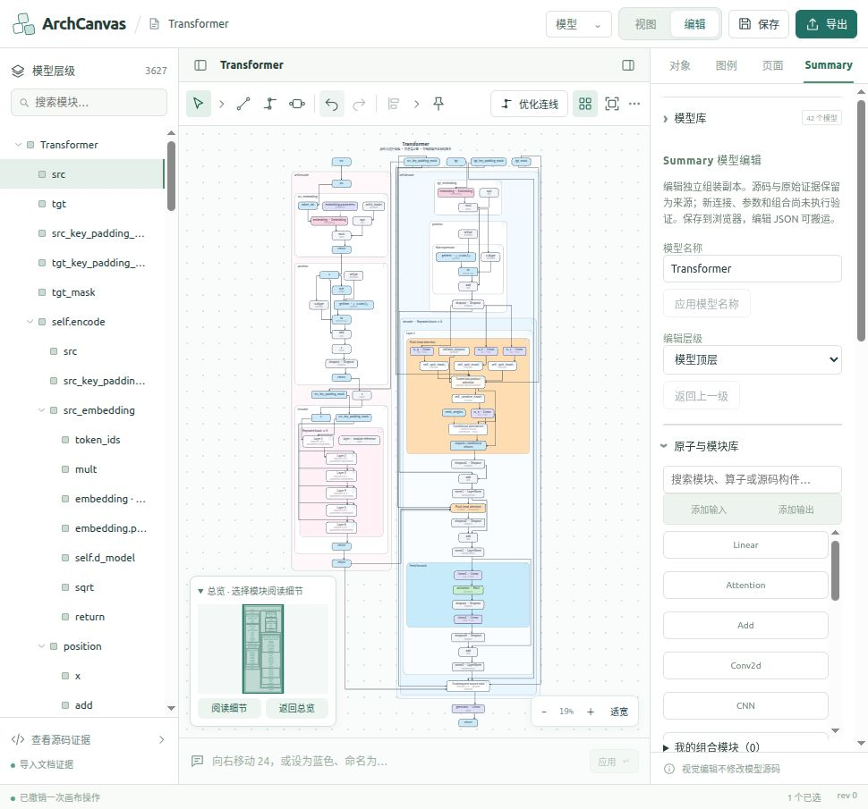

# 连续语义图各展开层级的交互性能优化

日期：2026-10-28。接续同日的移动／展开优化，修改限于正式 Studio 的 Summary 运行时及回归测试。主程序面板和编辑、源码事务继续使用既有契约。

## 本轮处理的重复开销

| 位置 | 原因与修改 |
| --- | --- |
| `generic-semantic.js` | 对本运行时递归冻结的证据缓存规范化和序列化结果；可变对象、外部浅冻结对象仍逐字段比较。启用已有的私有源码认证上下文，先完整验证再认证，检查核心对象、拓扑和精确绑定；不使用保存文件中的可信标记。 |
| `studio-semantic.js` | 将展开预设、关闭自适应等状态在投影之前完成，避免操作验证后再替换 state，使随后的属性面板、拖动和校验重复构造整个语义切面。返回操作仍恢复自身状态。 |
| `physical-ports.js`、`source-contracts.js` | 每次同步校验／路由构建节点和关联端口索引，避免每条边再次全图扫描。物理端口与同值对端占位仍读取实时数据，上下文不跨操作缓存。 |
| `semantic-constraints.js` | 复用经过完整校验的源码上下文，逐候选检查可变端点和契约；按实际线段查询 BVH 障碍候选，继续执行原有精确几何判定。边框间隙改为按需计算；高频边框接触判断改为等价、无数组分配的布尔判定。查询保留原容差范围。 |
| `graph-engine.js` | 同次操作复用源码检查结果及物理端口索引，避免重复源码比较；无共享干线时跳过干线保留的昂贵扫描。 |
| `router.js` | 简单路径障碍查询与交叉统计使用已有 `SemanticGeometryIndex`，精确相交判据保留；索引仅在本次几何中有效。 |
| `app.js`、`studio-presentation.js` | 每次渲染索引节点和关联端口。拖动预览只更新实际移动节点与关联边，保留其他图元实例；呈现层直接使用已索引的边元素。实时候选使用共享不可变源码的独立几何快照，松手后仍执行正式验证。 |

没有降低路由搜索预算，也没有通过跳过源码、操作数、容器、端口、边界、节点重叠或最终提交验证来缩短时间。缓存只减少已证明不可变事实的重复计算；几何变化仍独立验证。未知语义和 CPU 运行证据的来源与覆盖约束保持有效。

## 同驱动前后测量

驱动：`scripts/benchmark_summary_depths.mjs`。Node v24.19.0，正式 vendored 资产；Transformer `0216717d966327f4`，3371 个源码节点、3663 条依赖。对 `self.encode` 逐级改变深度，其余模块保留自身状态；f0/f1 仅表示目标模块展开预设。后续移动样本不影响下一次展开样本。

优化前使用本轮修改前冻结的 9 个运行时文件，SHA256 与字节数见 `baseline-assets.json`；优化后最终文件见 `final-assets.json`。主前后对比均开启 V8 CPU profiling，串行运行。每项是单次样本，受缓存、预算截止时间和系统负载影响，不代表分位数或其他机器的延迟承诺。

下表是完整 `prepare` 引擎耗时，含投影、布线和验证，**不含浏览器 Worker 传输、宿主 React、持久化和屏幕刷新**。pending 表示尚未完成布线；strict 同时要求源码、布局与每条连接通过，`accepted:true` 仅代表可保留的语义／草稿状态，不能等同于完整合法图。

| 编码器预设／源码深度 | 可见节点 / 边 | 优化前 ms | 优化后 ms | 耗时降低 | pending 前 → 后 | 最终严格校验 |
| --- | ---: | ---: | ---: | ---: | ---: | --- |
| f0 | 61 / 63 | 3136.21 | 1689.44 | 46.1% | 0 → 0 | 通过 |
| f1 | 82 / 80 | 5120.56 | 2752.18 | 46.3% | 0 → 0 | 通过 |
| 0 | 52 / 52 | 2587.92 | 1410.16 | 45.5% | 0 → 0 | 通过 |
| 1 | 59 / 58 | 2348.31 | 1223.87 | 47.9% | 0 → 0 | 通过 |
| 3 | 87 / 88 | 2816.38 | 1555.12 | 44.8% | 0 → 0 | 通过 |
| 5 | 201 / 214 | 4086.80 | 2552.43 | 37.5% | 1 → 1 | 未通过 |
| 7 | 951 / 1054 | 11390.96 | 7531.57 | 33.9% | 132 → 36 | 未通过 |
| all | 1215 / 1306 | 12213.89 | 7497.45 | 38.6% | 30 → 30 | 未通过 |

浅层成功移动 8px 的引擎耗时：

| 所处深度／预设 | 优化前 ms | 优化后 ms | 实际位移 |
| --- | ---: | ---: | ---: |
| f0 | 560.78 | 23.59 | 8 |
| f1 | 585.16 | 28.33 | 8 |
| 0 | 408.11 | 17.71 | 8 |
| 1 | 405.88 | 18.91 | 8 |
| 3 | 464.19 | 25.55 | 8 |

这些移动均 `blocked:false`。深度 5、7、编码器全部展开时已有 pending 路由，移动仍被保护性拒绝、位移为 0；其较短返回时间不是成功移动的性能结果。

## 全图最深状态仍有的限制

整个根模块全部展开为 3371 节点／3663 边：prepare 从 **18549.79ms 降至 13755.58ms**，交叉统计从 393.09ms 降至 42.15ms。

但最终仍有 **2503 条 pending、2 条 failed**，源码校验通过，布局和整图严格校验未通过。优化前也未通过（pending 3513、failed 1）。相同预算内完成更多布线可能暴露更多真实失败，不能仅比较 failed 数认定图已修复。根层移动仍被拒绝。全图最深状态还不能称为流畅、完整可编辑；后续需要单独处理布线完成性和重型布局。

## 其他案例的最终补测

相同驱动补测 f0、f1、源码深度 0/1/3 和全部展开；各案例默认目标为其根模块，带运行证据的小 Transformer 使用 self.encode。深度高于源码自身结构时允许得到同一合法切面。本轮未执行 CPU 探针，仅使用原有归档证据。

| 案例 | 预设及深度 0/1/3 最慢 ms | 最深可见节点 | 全部展开 ms | pending / failed | 最深严格校验 |
| --- | ---: | ---: | ---: | ---: | --- |
| MLP | 160.60 | 19 | 10.02 | 0 / 0 | 通过 |
| ConvNet | 176.03 | 28 | 11.66 | 0 / 0 | 通过 |
| RNN | 187.17 | 22 | 9.26 | 0 / 0 | 通过 |
| WideBranches | 495.80 | 39 | 16.72 | 0 / 0 | 通过 |
| ImageResidual | 66.97 | 13 | 7.67 | 0 / 0 | 通过 |
| 带运行证据的小配置 Transformer | 435.54 | 235 | 4601.36 | 5 / 0 | 未通过 |

前五个案例各测量层级均通过严格校验。小配置 Transformer 的浅层均通过，编码器全部展开仍有待布线边，移动被拒绝；与大 Transformer 的深层限制一致，不能宣称所有最深状态都已可编辑。

## 浏览器实际操作与视觉核对

最终构建由正式服务 `http://127.0.0.1:8790/` 提供。当前浏览器打开已有 Transformer 编辑工作副本；不是覆盖或重置用户模型。该副本包含呈现差异，因此其 89 节点不能直接与未编辑基准的 87 节点比较。

- 编码器应用源码深度 3，其他模块保留自己的状态：89 个可见节点、94 条边。界面 frontier 计时 2983ms，其中 Worker 内部 940ms（build 739、route 186、validation 6）；这次 UI 展开样本与广回归并行，作为功能验证记录，不作为严格性能对照。
- 进入编辑模式，将顶部 `src` 横向拖动约 12 屏幕像素；实际画布位置 `translate(319 190)` → `translate(386.4046630859375 190)`，不是空操作。
- 8 次拖动预览记录的计算耗时 p50 0.9ms、p95 1ms、max 10.8ms；`data-preview-ms` 最后一次 4.70ms，最终渲染 5.80ms。这些是对应内部阶段的计时，不是输入到屏幕的完整延迟。
- 松手后的 `data-move-ms` 为 1043ms，包含后台提交往返。89 节点／94 边均保留，缺失节点为 0，仅目标节点 HTML 改变，保留图元实例；源码与布局校验均为 true。
- 通过正式撤销按钮恢复；逐节点 HTML 与逐边路径均与移动前完全相同，源码与布局校验仍通过。浏览器留在这张混合深度图。



## 回归测试与自省

广回归运行 334 项：332 项通过，2 项旧自适应测试失败。定位后用本轮优化前冻结资产复现了同样结果：完整角色候选与角色路径候选都产生合法增益，但实际测量选择了后者。旧测试固定要求前者胜出，并读取必定存在的 `paperRoleDetails`，与真实选优规则不符。只修改测试，保留对增益、精确证据、手动请求保留、关闭重规划及收起恢复的断言。

修正后，自适应、空间索引和交互回归 19 项全部通过。其余 332 项运行时代码未再变化，覆盖全部目录模型、中间切面源码记账、混合深度、3371 节点、编辑事务、JSON 重开、草稿、运行证据、Worker 真正传输、共享不可变源码与篡改拒绝。

新增等价性检查包括：

- 10000 组普通、近轴、短线段边框判定与原数学公式逐项比较。
- BVH 几何检查与全节点扫描的违规结果一致。
- 端口索引与扫描一致，端口对端变更后仍读取实时位置。
- 索引交叉统计与原二次扫描计数完全一致。
- 障碍索引路由与原全扫描路由一致，几何编辑不会复用旧障碍。
- 已提交切面的属性检查不触发额外投影；语义、标题、归属、展开、记账、契约、绑定与缺边的篡改均不能沿用认证。

`npm run build` 通过（保留现有大 chunk 和插件耗时提示）；vendor/integration 合并清单 7378 资产校验无缺失、字节或 SHA256 不匹配。`git diff --check` 通过。

## 复现与证据文件

```bash
node --cpu-prof --cpu-prof-dir=/tmp scripts/benchmark_summary_depths.mjs \
  . docs/evidence/summary-depth-performance-20261028/after.json \
  0216717d966327f4 f0,f1,0,1,3,5,7,all

node --cpu-prof --cpu-prof-dir=/tmp scripts/benchmark_summary_depths.mjs \
  . docs/evidence/summary-depth-performance-20261028/full-after.json \
  0216717d966327f4 all Transformer
```

本次优化前快照仍在 `/tmp/summary-depth-before-assets`；将 `SUMMARY_BENCH_ASSET_OVERRIDE` 设为该目录可用同驱动重跑优化前版本。该临时目录会随环境清理，持久证据是本目录中的原始测量、资产哈希和日志。

| 文件 | 内容 |
| --- | --- |
| `before.json`、`after.json` 及对应日志 | 编码器预设与深度、独立校验、面板、快照、统计、移动结果 |
| `full-before.json`、`full-after.json` | 3371 节点的真实性能和未解决布线状态 |
| `case-*.json` 及日志 | 其他六个案例的多层级补测 |
| `baseline-assets.json`、`final-assets.json` | 本轮前后 9 个资产的精确哈希 |
| `tests.log`、`targeted-final.log` | 首次广回归原始结果及修正后相关测试结果 |
| `adaptive-before.json`、`adaptive-after.json` | 旧测试假设在优化前后均不成立的诊断证据 |
| `build.log`、`asset-audit.json` | 构建与全部资源审计 |
| `ui.json`、`ui-depth3.png`、`ui-drag.png`、`ui-final.png` | 真实浏览器节点／路径、阶段计时与视觉证据 |
