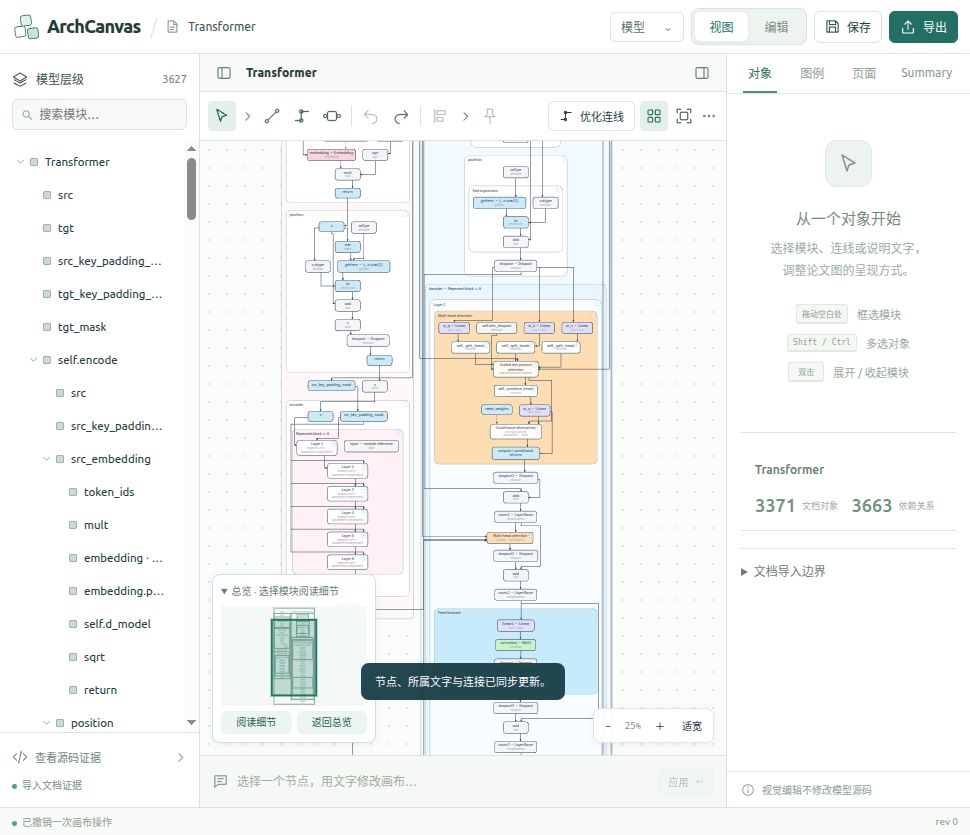

# 拖动开始卡顿修复与浏览器实测

日期：2026-10-29。范围是正式 Studio 当前画布的鼠标拖动反馈，不更改源码语义、展开切面或正式源码事务。

## 原因

此前的 `data-drag-profile` 从移动处理函数开始计时，没有覆盖鼠标按下事件中的同步工作，因此帧内计算快不能证明开始拖动不卡顿。

`begin()` 在捕获鼠标后立即调用桥接 `state()`；该调用同步执行 `studioDocument()`，组装并复制完整模型、原始 IR、authoring 文档与选择证据，再通过 postMessage 传给宿主。宿主在判断 `snapshot.busy` 前已经执行整图 `JSON.stringify`、脏状态比较及面板版本更新。随后 `nodeDown()` 又触发普通场景渲染、检查器与选择证据构造。首次拖动反馈因此排在大量与位置反馈无关的工作之后。

另有两个反复开销：源码条件关联的绘制及图例在每次拖动渲染中计算完整几何签名；自动保存定时器在检查 `drag/busy` 前已经复制 authoring workspace。

## 修改

| 位置 | 行为 |
| --- | --- |
| `studio-bridge.js`、`app.js` | 自动 busy 通知改用 `interaction`，仅传 `caseId/busy/dragging/canCancel`。手势及 Worker 进度不构造完整文档，自动保存完成也不重复发送整图。显式 snapshot、保存、导出及最终 idle state 保留完整协议。 |
| `PreviewStudio.tsx`、`App.tsx` | 单独处理轻量状态；更新按钮、取消操作与 Escape 所需标志，保留已提交图、选择证据、源码绑定和面板投影。取消按钮使用独立 React 状态，确保 busy 不变而 canCancel 改变时也会更新。 |
| `app.js` | 手势按下时只刷新本地选中框／端口手柄；移动沿用已有 rAF 合并、局部节点与关联连线更新。检查器与选择证据推迟到释放或取消。完整历史快照、提交校验及失败回滚仍保留。 |
| `source-controls.js`、`studio-presentation.js` | 拖动预览隐藏可能失效的条件关联及其图例，不再为它们反复序列化整图。松手后的正常绘制恢复与当前几何一致的标记。张量依赖仍按原来的局部预览更新。 |
| `app.js` 自动保存 | 先检查手势／后台事务，忙碌时延后保存，不复制中间几何或 workspace；手势结束后正常保存。 |
| `App.tsx` 绑定缓存 | 同一架构、源码和宿主图对象的状态更新复用已有绑定；替换图、架构或源码时重新核对映射签名，不使用标签或顺序猜测身份。 |

操作反馈与合法提交仍是两个阶段。拖动中的轻量几何不被当成已验证的正式模型；松手后的 Worker 仍验证源码、布局和连接，失败则恢复原位置及历史。单击、多选、框选、端口、说明文字、撤销、重做和取消继续使用原有操作协议。

## 实际浏览器测量

在侧栏现有 `http://127.0.0.1:8790/` 正式程序操作，没有通过浏览器脚本写入状态或调用隐藏图 API。测试为三次真实鼠标小幅水平拖动，分别撤销。当前 Transformer 的原始源码为 3371 节点／3663 依赖，混合展开视图显示 89 个节点，缩放 25%，交互模式为 compat。

单位：毫秒。单次样本，不代表所有模型或硬件的性能上限。

| 对象 | 首个移动事件到 DOM 更新 | 本次最慢事件到 DOM 更新 | 后台移动提交 |
| --- | ---: | ---: | ---: |
| 编码器内部重复模块 | 25.20 | 25.20 | 67.90 |
| 解码器 Scaled dot-product attention | 29.80 | 29.80 | 72.80 |
| 源码计算 `w_o · Linear` | 15.60 | 15.60 | 73.20 |

首次移动的历史快照开销分别为 18.70、13.70、8.30ms，已经计入首帧处理。三次都完成实际位移，最终源码与布局约束均为 true。注意力模块坐标 `1025,1483 → 1042.847...,1483 → 撤销回 1025,1483`；计算节点 `1141,1677 → 1158.846...,1677 → 撤销回 1141,1677`。编码器模块最终还原到 `285,2041`。

诊断字段区分：`data-pointer-input-delay-ms` 是按下事件送达处理器前的等待；`data-pointerdown-to-frame-ms` 是按下事件到下一次 rAF 回调（包含事件送达、处理与调度，并非显示器实际呈现）；`data-drag-first-input-to-dom-ms` 与 `data-drag-max-input-to-dom-ms` 包含 rAF 等待和本次移动处理；`data-drag-snapshot-ms` 是首次历史快照；`data-move-ms` 是松手后的后台提交时间。事件到 DOM 更新不是显示器实际呈现时间，截图也不能证明连续帧率。本轮没有采集旧版端到端同条件基线，因此不宣称倍数提升；也不将 3371 个原始节点等同于本次同时绘制 3371 个节点。完整实时布线模式与全部源码节点同时展开的耗时不由这三组样本覆盖。

初次采样的 `data-pointerdown-ms` 使用捕获阶段的 microtask，可能在后续事件处理器之前执行，不能代表整个按下处理，已从最终诊断与表格移除。该计时问题不影响上述移动事件到 DOM、快照及后台提交测量。最终构建改用按下事件到下一次 rAF 的指标。

首次反馈计时还排除了没有改变指针预览位置的事件，避免把空帧记作真正的移动反馈。最终源码条件绘制与诊断专项共 19/19 通过。

最终计时器修正后再次通过真实鼠标复测 `w_o · Linear`：按下到下一帧 2.30ms，首个有效移动事件到 DOM 28.10ms，后台提交 88.80ms。坐标变化与撤销、源码与布局校验均通过，见 `final-smoke.json`。

## 验证与证据

- 相关回归 70/70 通过，覆盖真实 Worker 传输、历史快照、共享源码隔离、移动几何与路由、失败恢复、取消、多选、源码条件关联和宿主桥接。
- 新增 `summaryGestureLatency.test.ts`；最终专项 7/7 通过，覆盖忙碌通知不生成文档、显式快照及同源限制、按下反馈不遍历场景、忙碌自动保存延后、宿主标志与源码／选择隔离、源码标记隐藏／恢复、绑定缓存世代失效、无位移鼠标事件不被计为首次反馈。其中 5 项已包含在上面的 70 项回归，另补充缓存世代与无位移事件计时 2 项测试。
- `npm run build`、修改的 JS 语法检查与 `git diff --check` 通过。现有产物大 chunk 提示仍存在。
- vendor 与 integration 合并清单：7378 个资产，0 缺失／字节／SHA256 不匹配。
- 测试移动已撤销，保留用户的模型与混合展开状态。截图是还原后的主程序。

证据目录：[summary-drag-latency-20261029](evidence/summary-drag-latency-20261029/)，包括 `browser-samples.json`、`final-smoke.json`、`final-diagnostics-source-controls-tests.log`、`ui-final.png`、`tests.log`、`gesture-tests.log`、`build.log`、`asset-audit.json`。

