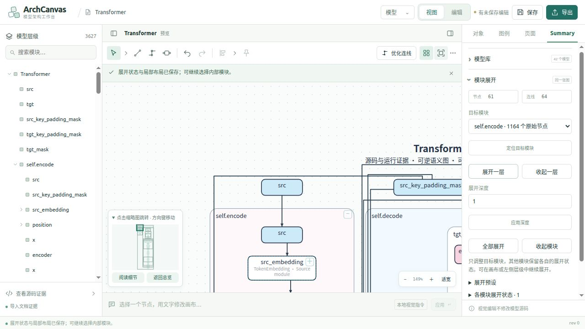

# Summary 模块移动与展开性能优化

日期：2026-10-28。修改位于正式 Studio 的 vendored preview，运行时不依赖 prototype 目录。

## 问题与修改

本轮对照 `prototype/Summary_Merge/docs/generic-interaction-performance.md`、`generic-full-source-performance.md` 和原版移动代码，采用不可变源码共享、局部路径修复、已有布局复用及严格提交校验。参考文档的历史数字没有用作当前性能证据。

| 文件 | 调整及目的 |
| --- | --- |
| `studio/public/preview/yworks_edge_router_lab/graph-engine.js` | 原生语义图移动使用有界的路由参数；小幅拖动先尝试修复已有路径，再搜索其他物理端口。遵守 `boundaryLanes:false`，不为美化边界通道重新布置无关连线。标题容器不限制子节点拖动，预览与提交使用同一规则。搜索共享两秒截止时间；完整校验时间另计。 |
| `studio/public/preview/yworks_edge_router_lab/generic-semantic.js` | 展开后，对端点、尺寸、展开状态及精确绑定一致、位移相同的连线，先平移已有路径和折点，再检查当前障碍、端口、边界与已保留连线。其余连线正常重新布线。复用不可变 IR，并只对内部冻结的源码缓存完整内容序列化结果。增加 build/route/validation 分阶段计时。 |
| `studio/public/preview/semantic_studio/publication.js` | 缓存昂贵的源码语义分析，复制本次使用的 publication 工作计划后再装饰。避免后续切换修改此前的计划或已冻结历史记录，也避免每次复制整份 IR 后重新分析。 |
| `studio/public/preview/yworks_edge_router_lab/studio-semantic.js` | 普通模块展开使用第一条合法路径；不执行多轮全图美化，也不在这次交互中给交叉线做代价搜索。显式“优化连线”仍使用原有美化设置。返回总处理时间。 |

没有移除源码、操作数、端口、容器归属、节点重叠、独立值通道及最终整图校验。移动若无法保持合法连接，仍恢复操作前几何。新的复用路径必须通过当前图的校验；源码摘要、旧的 complete 标志或缓存命中都不能代替验证。未知模块与运行证据仍遵守原有证据边界。

## 同一驱动的前后对比

驱动为 `scripts/benchmark_summary_interactions.mjs`，调用正式 `ArchCanvasSemanticView.prepare` 和 `SummaryEngine.move`，使用同一目录资产、默认展开状态、目标模块及 8px 水平移动。优化前后 Transformer 对应配置都是 `0216717d966327f4`：原始 IR 3371 节点、3663 依赖；默认可见 82 节点。

时间单位为毫秒，单次测量，不代表分位数或所有机器的延迟承诺。前后主要基准均开启 V8 CPU profiling。Worker 序列化、宿主 React 面板和屏幕刷新不包含在这里的引擎耗时中，另在浏览器记录。

| 模型／操作 | 优化前 | 优化后 |
| --- | ---: | ---: |
| Transformer 收起首个展开的子模块，82 → 52 节点 | 14476.98 | 3250.90 |
| Transformer 返回原展开状态，52 → 82 节点 | 4656.43 | 1211.09 |
| Transformer 节点实际移动 8px | 203496.40 | 555.15 |
| MLP 收起模块 | 85.99 | 30.38 |
| MLP 返回展开状态 | 7.92 | 7.65 |
| MLP 节点实际移动 8px | 21.70 | 5.72 |

移动均为实际成功移动，`blocked:false`，位移为 8；不是通过拒绝操作获得较短时间。移动后再次独立执行完整校验。所有表中展开状态均 `strict:true`、`pending:0`、`failed:0`。

Transformer 编码器继续逐级展开，解码器保留自己的状态：

| 编码器源码深度 | 整图可见节点 | 时间（ms） | 复用连线／整图连线 |
| --- | ---: | ---: | ---: |
| 0 | 52 | 2779.98 | 31 / 52 |
| 1 | 59 | 2346.80 | 40 / 58 |
| 2 | 80 | 2597.71 | 48 / 78 |
| 3 | 87 | 2405.86 | 74 / 88 |

这些状态也全部通过严格整图校验，没有通过隐藏失败连线降低耗时。

## 其他模型及真实界面

相同驱动补测以下案例，移动、收起、返回展开状态及源码深度 0/1/2/3 均完成且严格校验通过。源码深度超过案例自身深度时，按现有规则得到相同切面。

| 案例 | 实际移动 8px（ms） | 深度 0–3 中最慢一次（ms） |
| --- | ---: | ---: |
| ConvNet · cnn | 7.55 | 211.52 |
| RNN · rnn | 4.61 | 210.12 |
| WideBranches | 38.47 | 503.55 |
| ImageResidual | 5.79 | 50.41 |
| Transformer，带归档运行证据的小配置 | 59.18 | 599.49 |

运行证据案例使用其原有构造参数和观察记录，本轮没有运行 CPU 探针，也没有与 3371 节点配置合并证据。

真实界面通过侧边浏览器操作正式 `http://127.0.0.1:8790/`：选择 Summary 编码器、收起和逐级展开；进入编辑模式，选中输入节点、放大细节、拖动、核对实际位置并撤销。早期界面测量得到移动后台往返约 873.10ms，节点 `translate(221 190)` → `translate(229 190)`，布局校验为 true，撤销正常。记录中明确区分此轮界面测量和最终构建复测。

编辑模式往返后的界面操作针对编辑工作副本，节点数可包含其工作区呈现差异；它们不应与基准的默认 82 节点状态直接比较。图元、边界和连线经截图检查，浏览器操作记录保存在 `ui.json`。

最终构建的浏览器复测：编码器收起耗时 2734ms，展开到源码深度 1 耗时 3013ms（含 Worker 往返和宿主处理）；对应 Worker 内部总耗时为 956ms、1186ms。两次源码与布局校验均为 true。



## 回归与证据

- 99 项：原生视图、全部目录资产、移动通道保留、真实 Worker 传输、共享源码、紧凑面板状态，以及新增移动／展开回归，全部通过。
- 7 项：混合语义切面的作用域替换、兄弟状态、源码与运行证据、可视草稿、源码编辑副本、JSON 恢复与篡改拒绝，全部通过。
- 新增测试验证实际位移、完整几何、精确绑定、不可变历史、收起再展开的原布局与连线恢复，以及碰撞移动回滚。
- `npm run build` 与 `git diff --check` 通过。构建仍报告现有的大 chunk 提示。
- vendor 与 integration 清单合并校验 7378 个资源，缺失／字节数／SHA256 不匹配均为 0。

证据目录：`docs/evidence/summary-interaction-performance-20261028/`。

| 文件 | 内容 |
| --- | --- |
| `before.json` / `after.json` | 优化前后主基准及优化后的分层展开 |
| `other-models.json` | 其他五个案例的操作、严格校验及分层展开 |
| `benchmark.log` / `other-models.log` | 驱动原始计时输出 |
| `tests.log` / `mixed-tests.log` | 99 + 7 项回归输出 |
| `build.log` / `asset-audit.json` | 构建与迁移资源完整性 |
| `ui.json` / `ui-*.png` | 浏览器实际操作记录与截图 |

复现主基准：

```bash
node scripts/benchmark_summary_interactions.mjs . /tmp/summary-interaction.json d6df94c94e8a5888,0216717d966327f4 levels
```

## 测量范围

3371 是本次 Transformer 的原始源码 IR 总节点数，不能把它写成“3371 节点全部可见时移动只需 555ms”。上述交互性能测量覆盖默认视图和表内混合展开状态；全部源码原子同时可见、第一次全量布线及显式全图美化仍可能超过五秒。本轮保留完整初次美化，默认 Transformer 首次构建仍约十四秒。大型切面继续沿用已有的预算和明确待布线状态，没有宣称所有切面均已即时响应。
