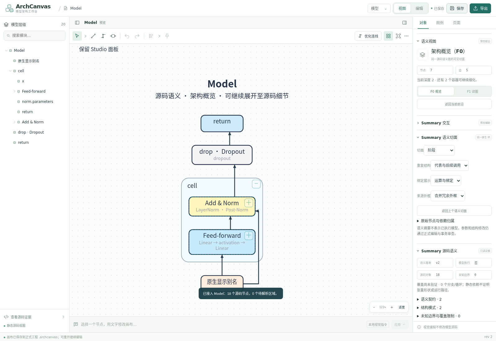
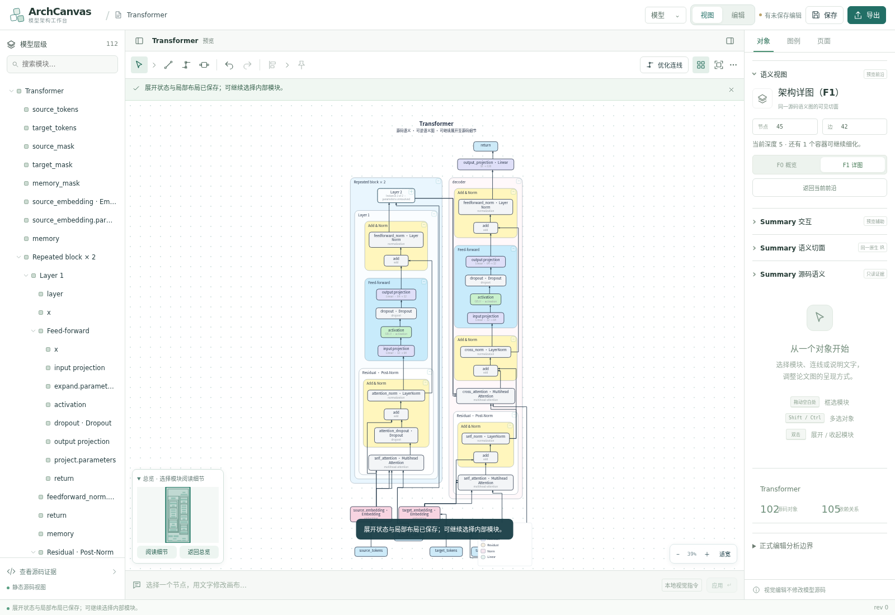

# Summary 原生语义视图替换与面板接入：2026-10-28

这是继 Python 语义底层替换后的第二阶段实现。新建 Summary v2 模型现在直接使用原型的原生语义投影、认证切面、原生图元和路由，而不是把 v2 事实降为递归深度 F0/F1。Studio 的顶部菜单、左右面板、图例、页面、编辑模式、事务和 CAS 继续保留。

当前整个迁移尚未结束。原生静态视图与认证切面已经替换；完整编辑组装、runtime/merged、多格式导入、测量反馈和千级图仍待接入。自主测试发现的 Transformer 布线缺口已修复，下面分别记录完整路线验证和预算耗尽行为。

## 实际替换链路

```text
正式服务的 Summary 静态分析
  → portable bundle（完整 native IR + canonical Python JSON）
  → source-adapter.validate/verify（来源与摘要校验）
  → studio-semantic → generic-semantic（原版纯语义投影）
  → semantic_studio 的 architecture/publication/composition-layout 等纯模块
  → native glyph/layout → 正式副本的物理端口/router/worker
  → committed snapshot → Studio 树和折叠 inspector
```

新增的 29 个语义模块和 3 个原生模块保持源文件字节；逐文件来源见 [原生迁入清单](summary-native-view-manifest-20261028.json)。`studio-semantic.js` 是正式适配层，负责限制命令、保留 source identity/视觉 overlays、发布只读切面摘要、标记未完成路线与相机恢复。不加载旧 semantic HTML、侧栏和 renderer。

当前图的 authority 按文档类型互斥：

| 文档 | 唯一当前图 | F0/F1 |
| --- | --- | --- |
| 新建 native v2 源码包 | `graph.generic.ir/state/receipts` | 原版 `frontier` / `certifiedDetails`；真实角色/阶段请求 |
| 旧 catalog、legacy adapter、明确恢复的旧递归编辑 JSON | `graph.recursive.authority/state` | 原有递归深度兼容前沿 |

`semanticHierarchy` 是同一 native cut 索引的只读导航投影；隐藏源码对象可导航，缺省占位坐标仅供 opaque 面板投影，不能作为正式源码布局。没有增加第二份语义事实或前沿算法。

## 功能和 Studio 面板如何衔接

| Studio 入口 | Summary 实际行为 | 保留的边界 |
| --- | --- | --- |
| F0 / F1 按钮、画布折叠菜单 | `set-frontier` → 原版 F0/certifiedDetails，单个 Worker/history 事务 | child 回报 preset 与 recipe；手动切面为 custom，React 不计算新前沿 |
| 右侧“Summary 语义切面” | 六档：总览、模块、阶段、语义边界、角色、值链与细节 | 全部 selector 读取已提交 snapshot，忙碌时禁用 |
| 重复结构、绑定、来源外框 | 原版 representatives/summary、bindings/boundary、compact/source 策略 | 保留所有原始节点/边及 exactly-once accounting |
| 所选边界认证角色、角色路径 | 精确 node、certificate 和角色 key 校验后调用原版 projection | 任意伪造 certificate/role、模式与 granularity 被拒绝 |
| 关系详图、返回切面 | 原生 relation/focus/back 导航 | 不凭 label 推断身份；历史保存原生 state |
| 左树点击隐藏源码对象 | 同一 cut index 查找，必要时 native focus 后选择真实对象 | 不能把语义聚合节点映射成单个正式编辑目标 |
| 展开全部 | 原版 fullyExpanded，显示源码单位 | 原始节点、边、producer/consumer、operand slots 不变 |
| 对象显示名、颜色、说明、图例、页面 | 原有 Studio visual 表单 → child overlays | overlays 跨语义切面保留，不写 native facts/Python |
| 端口布局 | 原生 affected wire 标为 pending，再交给原生 router 重算 | physical port 与 canonical port 分开，来源绑定不变 |
| 未完成布线 | pending/failed 计数、冲突路径、继续布线按钮 | complete 仅在二者均为 0；单次 8 秒预算不能承诺硬性超时 |
| 相机和撤销/重做 | 按实际 cut 保存最近四个相机，历史保存 live camera | 返回 F0 恢复自身几何/视口，非根据按钮名缓存 |
| 顶部保存和编辑 JSON | child IndexedDB + 正式 CAS；携带 native graph 与来源包 | native IR 必须等于重新验证的来源包，来源篡改拒绝 |
| 编辑模式/返回视图 | iframe 常驻，正式 Authoring 读取同一源码 | 参数、激活、重绑定、源码写回仍经过正式事务 |
| SVG 和原生 IR 下载 | 当前 child SVG；Python canonical JSON 原文下载 | SVG 不包含编辑命中层，IR 不经过 JS 数字重新封存 |
| 空选区模型统计 | 同一 committed `graph.generic.ir` 的源码对象和依赖数 | 原生图不再显示正式编辑解析器的计数；正式编辑诊断单独标明 |

正式 publication renderer、AuthoringStudio 和事务审查仍有 core 依赖；本阶段没有批量删除 `studio/src/core`。旧递归兼容行为继续有独立浏览器矩阵，不把旧 catalog 当作新 native 模型测试的替代。

## 验证和自省

本阶段测试资产位于 [evidence/summary-native-view-20261028](evidence/summary-native-view-20261028/validation.json)。该目录记录当前代码的测试及指纹；上一阶段 851 项测试是历史证据。

- 补齐原生 router 后的完整 `npm test`：866 项，865 通过、0 失败、1 项因沙箱阻止 Chromium 启动而跳过。末次只修正了空选区面板的计数/标签，之后重跑当前 65 项专项、原生与 Transformer 浏览器 19 项、构建和独立副本；不把该末次面板改动之前的完整回归冒充成之后再次执行。
- 面板/bridge/原生定向 65 项通过；补齐 router 后另外执行强化的 15 项原生测试，5 个正式 fixture 的 F0/F1/source-unit 均要求完整合法路由。覆盖 native 原生 IR 守恒、F1 recipe、六档切面、角色伪造拒绝、精确归属、原子层 roundtrip、源码未知边界、overlays、相机、预算耗尽及继续布线。
- 实际 Chromium 已通过原生 Studio 16 项、旧案例兼容 23 项、Transformer 三档 3 项，三组均无 browser error。原生组覆盖导入、折叠面板/树、F0→F1→F0、认证角色、隐藏节点聚焦、源码单位展开、物理端口、连接手势、视觉属性、编辑 JSON 恢复/篡改拒绝、双模式、保存刷新、SVG 和原生 IR 下载。Transformer 三档在本次浏览器运行中均无需继续布线，源码和全部几何/路由守卫通过；结果逐项保存在 validation.json。
- 5 个正式 fixture 通过原生 Python 分析、三档完整节点/边 accounting 和全部路线检查，包括 Transformer 的 26/45/102 个可见节点和 30/42/105 条边。强化 fixture 测试使用每轮 30 秒预算、至多一次继续；它与产品默认 8 秒预算分开记录。
- Transformer 修复前：源码单位层保留 102 节点/105 边，但有 11 条失败路线，含错误端口入射、穿越无关容器和独立值共线。根因是新原生投影依赖的路由选项尚未迁入旧 router，部分选项被静默忽略。现已接入 Summary 的局部搜索裁剪、冗余障碍裁剪、容器通行坐标与逐段约束、优先当前端口和合法简单候选；完整来源、容器顺序、物理端口、独立线道守卫继续检查。修复前日志保留在 evidence；当前测试不再豁免 Transformer 路由失败。
- 默认 8 秒预算在竞争负载下仍可能留下 pending：一轮定向测试中源码层尚余 2 条，后续严格 30 秒测试全部完成。pending/failed/complete 必须与真实状态一致；不能把预算不足变成来源错误，也不能把未完成图标成完整布线。
- 单次 native 路由默认预算 8 秒，已开始的一次 route search 不会被强制截断；它不等于严格的主线程/Worker deadline。复杂模型的取消、进度与增量缓存仍需完善。
- 最终构建、独立源码副本的来源/能力/5 个 fixture 分析和构建均通过。正式 HTTP 的 60 个当前集成资源共 3,733,106 bytes，与 dist 完全相同；56 个集成资产的 public/dist 指纹一致，32 个原版模块保持来源字节。完整独立性清单保存在压缩 JSON，摘要与当前运行时指纹校验见 evidence。





## 与原版 generic-controls 的逐控件核对

原版侧栏没有挂入 Studio；下列是按实际 `generic-controls.js` 的事件绑定核对的入口，防止只迁主按钮而遗漏细节。

| 原版入口 | Studio 当前接法 | 尚需验收 |
| --- | --- | --- |
| nativeOverview / nativeDetail / nativeBack / nativeSource / nativeContinue | F0/F1、返回切面、展开全部、继续布线；Transformer 三档合法路线已验证 | 更大图、严格取消与交互预算 |
| nativeGranularity / nativeSequence / nativeRead / nativeFrames | 右侧“Summary 语义切面”的四组 selector | 较大图与多种真实重复结构的面板组合 |
| nativeFind / nativeFocus / nativeFocusGo | Studio 层级搜索及 child exact focus | 多个同名/共享调用的广泛导航样本 |
| 完整证据、路径过程、资源/外框归属 | 同一折叠面板的所选图元 details | CPU 证据不存在时保持静态来源说明 |
| “结构代表”与“恢复源码外框” | 使用 proved 重复组、精确 focus/group 和原版 frame policy | 多类型重复组浏览器矩阵 |
| 语义配色与线型说明 | 原版 native 图元和依赖线型；Studio 图例面板保留 | 按当前可见 native 分类自动生成图例入口尚未全部适配 |
| nativeEvidence / nativeRuntimeRun / nativeProbe | 目前仅 source 模式，未接 CPU UI | 正式隔离、input/mode、receipt、有限覆盖 |
| nativeView / nativeEdit | Studio 双模式，iframe 常驻 | Summary AuthoringModel 的全部原子/槽位操作适配 |
| nativeNew / nativeInput / nativeOutput / nativeDuplicate / nativeErase / nativeGroup | 已有正式 AuthoringStudio 入口 | 尚未完成与 Summary 原始对象/槽位语义的逐项等价验收 |
| nativeTemplate / nativeAddModule / nativeCompile | 正式模块库和源码模块入口 | Summary library/templates/replaceModule 的完整适配 |
| nativeReadRecipe / nativeRecipeBlank / nativeAddPart / nativeRestoreWires | 尚未接 Summary 的参考构件组装流程 | identity 保留、精确原连接恢复和来源审查 |
| nativeOutputPort / nativeInputPort / nativeReplace / nativeConnect / nativeRewire | 视觉连接草稿已接；正式编辑仍走原端口/事务入口 | Summary 的精确语义槽位、替换已有输入和原始边重接映射 |
| 编辑节点名称、constructor/arguments 草稿、完整源码替换 | 正式显示/参数/源码编辑入口 | 不能把 visual alias 或草稿连线当作这些语义操作已迁入 |

## 剩余迁移清单

| 能力 | 当前状态 | 下一步 |
| --- | --- | --- |
| Transformer 完整合法布线 | 已补齐 Summary 原生路由选项；三档严格路由回归通过 | 继续评估默认 8 秒预算下的交互延迟与更大图 |
| measured adaptive-frontier | 模块复制，未接 renderer 测量反馈 | 不能把 certifiedDetails 的 F1 recipe 当成测量优化已完成 |
| runtime / merged 和 CPU 补证 | 数据模块在包内，工作台只暴露 source 模式 | 接正式隔离 profile、明确输入、receipt 和样本覆盖说明 |
| native/semantic-canvas/architecture/authoring 多格式导入 | 原版 G.read 在包内；工作台只接来源包和带 adapter 的编辑 JSON | 增加显式格式入口、重新验证、preview-only 来源状态与导出 |
| 原型通用模型目录 | 旧230案例资产保留；新通用目录未完整迁入 | 按来源可用性分类并迁入当前原型的精确索引 |
| 原型 AuthoringModel 全操作 | 模块因依赖迁入，操作尚未逐项适配 | 保留 Studio 编辑壳，补槽位/共享实例/组合/替换与正式事务映射 |
| 千级图 | 桥接仍480节点；本阶段只增加原生 pending/继续机制 | 扩预算、避免重复 IR 传输、完善取消与恢复，独立压力测试 |
| D0/D1 旧实现移除 | 未整体删除 | 按对比文档 importer graph 拆分，保留 formal authoring/publication 用途 |

新代码、旧代码的数量不能替代上述逐项验收。后续迁移继续以 Summary 的语义/图元/交互为主，Studio 保持面板和正式模型工作流。
