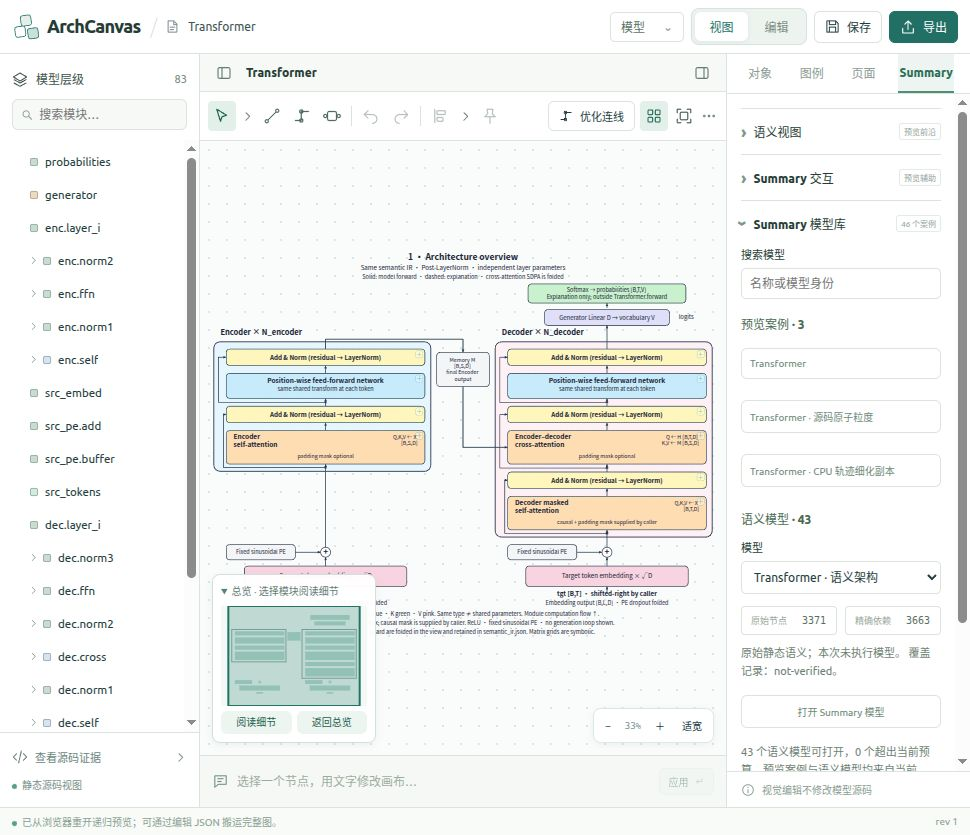

# Summary 标签页与当前模型库整合（2026-10-28）

## 面板职责

右侧四个并列标签为「对象」「图例」「页面」「Summary」，沿用正式 Studio 的标签、属性字段、按钮和折叠分组。参考旧 Temp 的面板职责划分，仅阅读其 `studio/src/App.tsx` 中的属性组织方式；没有导入其运行时或建立依赖。

- 对象：当前节点、连线、说明文字的选区、显示名称、颜色、线宽、排列、源码定位和正式参数/连接编辑。选择对象不会把正在使用的 Summary 标签强制切走。
- 图例：保留原有图例编辑功能。
- 页面：保留页面宽度、背景、配色和说明文字。
- Summary：语义视图 F0/F1、交互辅助、Summary 模型库、语义切面、CPU 观察、源码语义证据，以及编辑模式下的原子/模块库、声明编辑、精确连接、组合、重建、源码模块重解析和复核。使用既有折叠面板。

顶部「模型 → Summary 模型库」直接展开右侧并切换到 Summary。进入 Summary 编辑或新建空白 Summary 模型也切换到此标签。模型库保持挂载，切换其他标签时保留搜索和模型选择。「浏览已保存与导入模型」也收在此库内，保留浏览器中已导入/保存模型的切换入口；其预览抽屉只列当前 3 个案例与用户文档，不再列旧目录。

## 当前案例替代旧入口

原「内置示例」下拉框及独立的「示例与模块库」主菜单入口移除。首次启动没有可恢复文档时，从 Summary 语义目录打开默认模型，不再请求 `/api/examples` 或加载正式程序的旧内置示例。已有保存画布仍可恢复。

统一模型库共 **46 个案例入口**：

1. 当前 `prototype/Summary_Merge/data/semantic/catalog.json` 的 43 个原生语义模型，沿用已有 `studio-catalog.json` 的摘要、完整性检查、预算和原生文档导入流程。
2. 当前 `prototype/Summary_Merge/data/catalog.json` 的 3 个预览案例：Transformer、Transformer · 源码原子粒度、Transformer · CPU 轨迹细化副本。

预览案例通过带请求确认的 `open-case` 消息打开。原子粒度携带原有概览/模块/详细布线模板；CPU 副本携带其独立模板与完整 306 节点权威图。递归创建以 `source-atomic` 为详细权威，并把原子证据带入对应模板节点。案例切换失败时保留当前画布，并把错误返回主程序。

预览运行时改为加载 `data/summary-cases.js`，其内容与同目录 `summary-cases.json` 来自当前 Summary 的 3 项目录。旧 230 项 `data/catalog.json`、`catalog.js` 和相关资产作为离线回归/历史素材保留，运行时导航不再加载这些目录。此次没有批量清理历史资产、正式源码解析/执行能力或用户保存记录。

源码原子图使用相同 Transformer 的已有源码证据；CPU 轨迹副本不通过标签匹配冒充经过验证的 Python 绑定。查看、展开已有 CPU 记录不会重新执行模型。

## 文件与独立性

新增资产记录：`docs/summary-current-cases-manifest-20261028.json`。记录当前三个案例、需要的图和模板、大小与 SHA-256。案例资产在正式 `studio/public/preview` 中自包含，构建和运行不读取原型目录。

更新 `integration-manifest.json` 中本次变更的运行时、目录和源码索引记录。历史迁移验收记录保持原来的时间点含义，不覆写为本次代码的证明。

## 验证

- `summaryCurrentCases.test.ts`：目录读取、案例资产摘要、三个真实权威图、Worker 初始布线、详细展开与折叠、源码与布局校验、完整权威不变。
- `previewApp.test.ts`、`previewFrontierTask.test.ts`、`previewHierarchy.test.ts`：导入、绑定、保存、恢复、选择和层级/前沿回归。
- 生产 TypeScript/Vite 构建与实际侧边栏浏览器交互检查。

### 本次实测结果

- 43 个语义模型与当前 Summary_Merge 的身份、名称和完整 IR 字节逐项一致。
- 目录完整性及全部原生模型回归 48 项通过；当前 3 案例及导入/层级/Worker 回归 36 项通过；最终导入、请求顺序与恢复回归 28 项通过。
- 浏览器验证：默认首次启动载入 Summary Transformer；源码原子图、CPU 副本、MLP 打开成功；CPU 案例 F1 从 16 节点细化到 35 节点；MLP 编辑功能进入 Summary 标签；页面属性保留；跨标签搜索保留；已保存模型抽屉只列当前案例和用户文档，分类不再显示旧目录。
- 生产构建通过，`git diff --check` 通过。构建仍有原有的入口包大小提示。
- 完整前端回归 997 项：初跑 995 通过、1 失败、1 跳过；唯一失败为旧「示例与模块库」菜单断言，按本次替换要求更新后重跑 1 项通过。最终未解决失败为 0；1 项 DOM SVG 测试因沙箱阻止 Chromium 启动而跳过。详情见 [validation.json](evidence/summary-panels-20261028/validation.json)。

界面截图：

