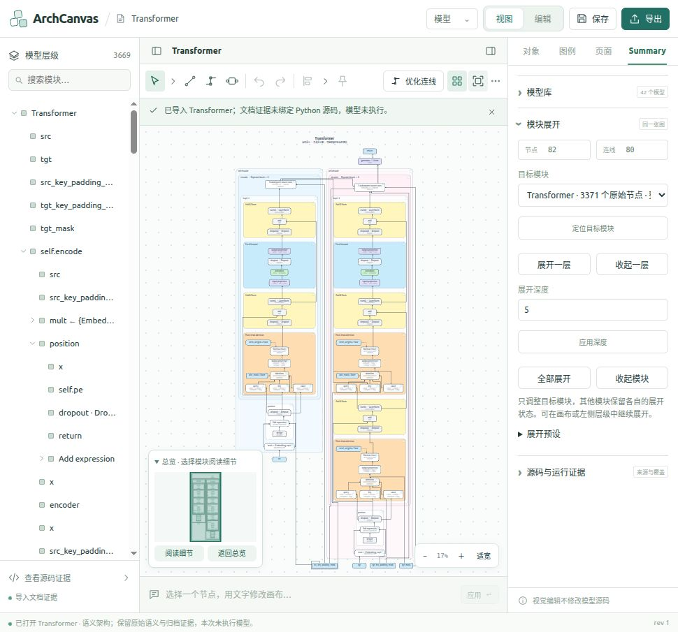

# Summary 面板精简与连续语义图入口

日期：2026-10-28。适用正式项目 `ArchCanvas_Model_Architecture_Studio`。

## 本轮结果

Summary 顶层收敛为三个区域：**模型库、模块展开、源码与运行证据**。独立切换 F0、F1、源码、CPU 轨迹及合并图的主要按钮和选择器已移除。图的展开与证据显示分别控制；对象、图例、页面和正式源码事务入口继续保留。

这是入口和交互收敛。底层保留旧文档的读取、证据模式解释及原生语义投影能力，不批量重写历史文档或删掉其原始语义资产。

## 删除及合并的入口

| 原有内容 | 本轮处理 | 现在的操作位置 |
| --- | --- | --- |
| 独立“语义视图”卡片、F0 概览/F1 详图按钮及重复节点统计 | 删除整块 | “模块展开”提供唯一统计与目标模块控制 |
| 画布选项中的 F0/F1 按钮 | 删除 | “展开预设”内的“架构概览 / 模块详图”，默认折叠，作用于所选目标子树 |
| 模块切面及全局切面两个选择器 | 删除 | 展开/收起一层、数字深度、全部展开、收起模块 |
| 源码 / CPU / 合并互斥选择器 | 删除 | 同图“显示已匹配运行证据”与观察记录选择 |
| 独立“新 CPU 观察”卡片 | 合并 | “源码与运行证据 → 添加运行证据”，两层默认折叠 |
| 独立“Summary 源码语义”卡片 | 合并 | 同一证据区域中的“源码证据” |
| “Summary 交互”卡片：拖动模式、上次路径、安全边界、快照诊断及重复布线按钮 | 删除整块 | 工具栏保留优化连线、布线设置；对象面板保留连接点编辑 |
| 自适应策略、重复摘要、绑定展示、来源外框、角色路径及语义关系的直接调试控件 | 从 Summary 面板移除 | 保留语义内核、原有文档兼容和展开操作 |
| “打开本次观察结果”按钮及对应宿主切图函数 | 删除 | “保存本次观察证据”，保存完整证据 JSON |
| 模型库中三个 Transformer 视图型旧案例入口 | 移除按钮 | 原资产和旧文档导入兼容保留 |

“返回当前前沿”改名为“定位当前模块”。画布选项仍保留全图展开、收起及可撤销的初始视图恢复；它们调整同一张图。

## 模块展开交互

1. 在图中或层级树选择模块，或在“目标模块”中直接选择。
2. 用“展开一层 / 收起一层”递进操作；输入深度后点“应用深度”。
3. “全部展开”展开目标模块全部合法源码后代；“收起模块”只留下目标边界。
4. 展开另一个模块时，其他分支保留自己的设置。可以将一个分支展开到源码而让另一个分支保持概览。
5. 需要快速开始时，打开折叠的“展开预设”，应用架构概览、模块详图或恢复目标默认设置。F0/F1 仅作为内核预设值，不再作为主视图标题出现。
6. “各模块展开状态”默认折叠，用于查看混合深度、选择目标和定位。

显式重设目标子树时会发送 `replaceDescendants: true`：清理目标内部更具体的旧覆盖设置，避免子模块 F0 阻止“全部展开”，或子模块源码设置使“收起模块”失效。目标外的同胞覆盖设置保留。旧调用不带此字段时，继续保留原来的嵌套覆盖行为。

原生语义内核和旧登记预览都支持此可选字段。变更不修改原始 IR，也不回写 Python，前一历史图不被就地修改。编辑副本继续携带模块展开设置。

## 模型库及配置

当前目录仍有 **43 份完整原生实例资产**；UI 显示 **42 个模型入口**。分组只使用已有证据能够匹配的入口源码单元摘要、类和 notebook cell；无法建立该身份的条目保持独立，不按显示名称强行合并。

Transformer 的两个实例归入一个入口，在默认折叠的“模型配置”中选择：

| 实例 | 构造配置 | 原始节点 | 观察记录 |
| --- | --- | ---: | ---: |
| `0216717d966327f4` | 默认构造参数（6 层、512 维） | 3371 | 0 |
| `328d7c8e671ab937` | 明确的样例参数（1 层、8 维等） | 1194 | 2 |

两个实例的入口源码单元摘要相同，构造配置不同。打开配置载入对应完整实例，运行记录始终归属该实例；不能把小配置观察当成默认大模型的运行证据。

旧登记入口分别是 `Transformer`、`Transformer · 源码原子粒度`、`Transformer · CPU 轨迹细化副本`。移除的是这三套并列视图按钮；原生模型、资产、历史读取和导入能力保留。

## 运行证据与实际边界

- 已有观察记录可在当前图中显示；关闭显示恢复源码展示。切换记录只修改证据显示参数，保留模块覆盖设置，不自动执行模型。
- 未观察路径、未匹配调用以及缺少源码文本的状态继续明确展示。已有记录并不授予源码事务权限。
- “添加运行证据”保留显式输入、构造参数、运行模式、隔离环境检查、取消和完整收据。缺少隔离环境或 Python 文本时不提供可执行表单。
- **本轮没有实现新探针结果自动附加回当前图。** 新结果有完整 JSON 保存按钮，界面明确提示结果尚未附加且为临时状态；切换模型或关闭面板前应保存。已有文档内的观察记录仍可直接选择显示。
- 编辑模式仍显示组装、原子、模块、源码重解析及正式源码审查功能；视觉操作继续遵循原有源码与事务边界。

## 本轮验证

构建 `npm run build` 通过（保留既有的大包体积提示）。相关测试共 **77 项通过**：

| 范围 | 数量 | 证据 |
| --- | ---: | --- |
| 面板实际处理器、模型分组、运行证据、取消与切换模型安全、登记预览 | 23 | [日志](evidence/summary-panel-simplification-20261028/panel-evidence-tests.log) |
| 全部 43 个原生实例打开、完整归属、文档恢复、摘要校验及拒绝篡改 | 48 | [日志](evidence/summary-panel-simplification-20261028/catalog-tests.log) |
| 混合模块命令、画布展开/收起、视觉草稿、编辑副本、证据模式、目标子树重设 | 6 | `summaryMixedFrontier.test.ts` 定向运行，包含新增的原生子树覆盖测试 |

测试命令在 `studio/` 下执行：

```sh
node --experimental-strip-types --test --test-isolation=none tests/summaryPanelSimplification.test.ts tests/summaryRuntime.test.ts tests/summaryRegisteredCuts.test.ts tests/summaryEvidenceViews.test.ts
node --experimental-strip-types --test --test-isolation=none tests/summaryCatalog.test.ts
node --experimental-strip-types --test --test-isolation=none --test-name-pattern='explicit subtree|module commands|scoped toggles|visual drafts|authoring copy|source and CPU' tests/summaryMixedFrontier.test.ts
npm run build
```

独立清单合并校验覆盖 7378 个预览文件，差异为 0，见 [资产校验](evidence/summary-panel-simplification-20261028/asset-integrity.json)。`git diff --check` 通过。

真实主程序 `http://127.0.0.1:8790/` 的界面验证：

- BranchMLP：根深度 0 时为 1 节点 / 0 连线；深度 1 为 12 / 12；深度 2 为 18 / 16。
- 根深度 1、true 分支全部展开、false 分支深度 0 时为 15 / 14；各分支设置同时存在。
- 显示运行证据并选择第 3 条记录后，原模块覆盖设置保留。
- 进入编辑副本、返回视图及切换对象/图例/页面后，混合展开设置保留。
- 再收起根模块，子分支覆盖设置清除，图回到 1 / 0；重新应用深度 2 后恢复 18 / 16。
- Transformer 模型选择器只有一个入口，模型配置中保留两个正确实例。最终主页面恢复到 Transformer。
- 旧语义视图与 Summary 交互卡片数量为 0；浏览器读取的错误日志为空。

本轮是 UI 入口清理及相关语义回归，没有重新执行所有案例的 3000+ 节点截图矩阵；此前结果仍记录在 `summary-all-cases-progressive-test-20261028.md`，不作为本轮新测试冒用。

## 截图

[混合展开与编辑模式](evidence/summary-panel-simplification-20261028/01-mixed-edit-mode.png) · [同图运行证据](evidence/summary-panel-simplification-20261028/02-runtime-evidence.png) · [Transformer 统一入口及配置](evidence/summary-panel-simplification-20261028/03-transformer-library.png)


