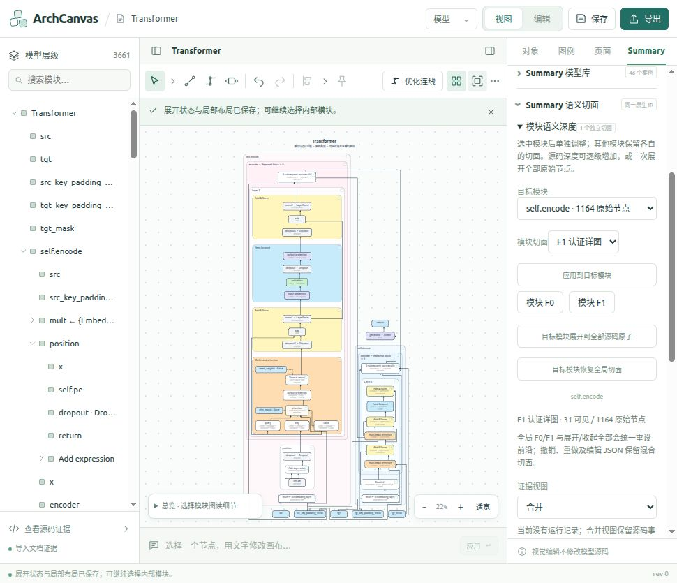
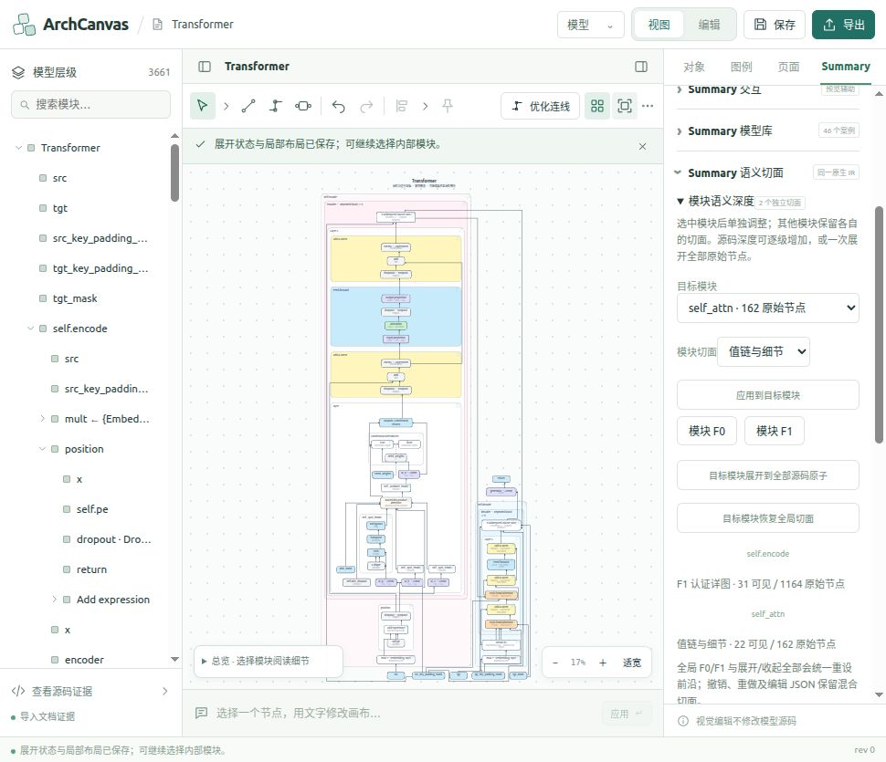
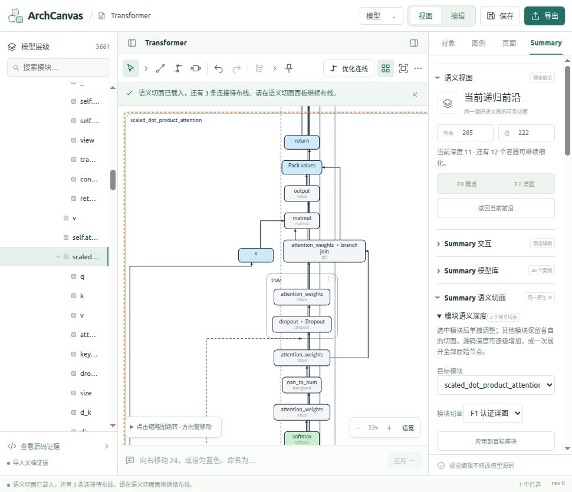
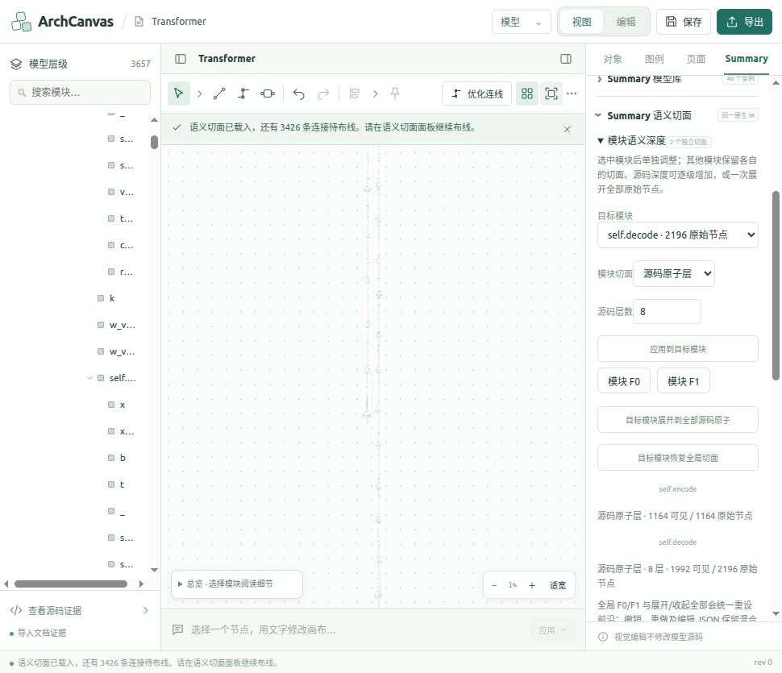
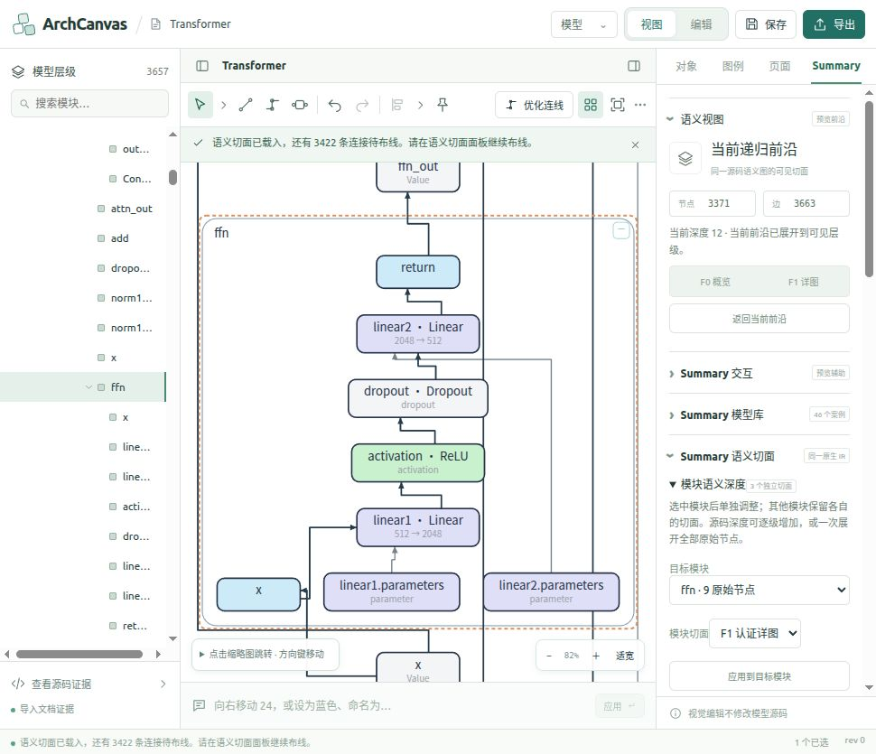
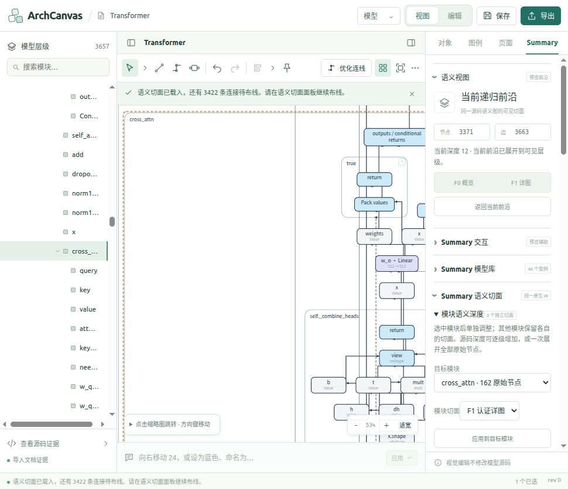

# 模块逐级展开到 3000+ 源码节点：浏览器实测与截图（2026-10-28）

## 验收结论

**语义展开通过；大图布局、布线和整体可读性未通过。** 本轮在正式主程序实际操作 Transformer 的 encoder、encoder 首层 attention、decoder 和模型根模块，保存 19 张未经加工的浏览器截图及对应 DOM 证据。没有修改运行时代码，也没有改写 Python 模型源码。

13 个主要展开状态覆盖 F0、F1、角色、值链与细节、源码深度 2/6/8 和全部源码原子。3371 节点包括容器、接口、值、参数、控制流及运算节点，并不等于 3371 个叶子算子。单个 encoder 只有 1164 个原始节点，因此通过多个模块组合验证 3000+。

全图从 30 → 51 → 52 → 65 → 161 → 205 个图元完成 attention 阶梯；清除 attention 覆盖后，encoder 源码阶梯为 49 → 410 → 1184；再展开 decoder 后为 1820 → 3164 → 3368；根模块全原子达到 **3371 节点 / 3663 条依赖**。这些不是一条全局单调递增序列，而是两个模块展开场景。

## 环境及边界

- 主程序：`http://127.0.0.1:8790/`，在 Codex 侧栏浏览器真实点击面板；截图约 970×835，未更改浏览器视口。
- 原生案例 ID：`0216717d966327f4`；浏览器使用既有 Transformer 编辑副本 `summary-authoring-9ff9bbfa-67a4-4869-800f-64e4d0f04c18`。
- renderer：`native-semantic/16`。证据视图沿用“合并”，此模型没有 CPU 运行记录，当前图保留源码事实。
- 所有浏览器 evaluate 仅只读 DOM，未注入应用状态、未通过内部函数绕过交互。3000+ 图的数组按每批最多 1000 个元素采集，避免浏览器工具返回数组长度上限导致证据截断。
- 源码层面的核对对象是迁入的 canonical source IR；本轮没有重新解析 Python、执行模型或补跑 CPU 轨迹，也没有重新测试所有案例。
- 本轮没有改动运行时文件，因此未重新构建或重复无关测试；运行了本报告附带的源码投影与 DOM 比对脚本。

## 全部实测状态与截图索引

“未通过路线”包含待布线及存在几何冲突的路线。布局失败不表示源码身份丢失，也不能因源码校验成功而忽略布局失败。每一行都有完整截图和 JSON。

| 状态 | 图元 | 边 | 源码映射 | 布局 | 未通过路线 | 证据 |
|---|---:|---:|---|---|---:|---|
| 全模型 F0 基线 | 30 | 37 | 通过 | 通过 | 0 | [截图](evidence/summary-progressive-source-expansion-20261028/01-global-f0.png) / [DOM](evidence/summary-progressive-source-expansion-20261028/01-global-f0.json) |
| encoder F1；decoder F0 | 51 | 54 | 通过 | 通过 | 0 | [截图](evidence/summary-progressive-source-expansion-20261028/02-encoder-f1-decoder-f0.png) / [DOM](evidence/summary-progressive-source-expansion-20261028/02-encoder-f1-decoder-f0.json) |
| encoder F1；首层 attention 角色层；decoder F0 | 52 | 54 | 通过 | 通过 | 0 | [截图](evidence/summary-progressive-source-expansion-20261028/03-attention-roles.png) / [DOM](evidence/summary-progressive-source-expansion-20261028/03-attention-roles.json) |
| attention 值链与细节层；其他模块保留 | 65 | 69 | 通过 | 通过 | 0 | [截图](evidence/summary-progressive-source-expansion-20261028/04-attention-detailed.png) / [DOM](evidence/summary-progressive-source-expansion-20261028/04-attention-detailed.json) |
| attention 源码深度 2；encoder F1；decoder F0 | 161 | 180 | 通过 | **未通过** | 42 | [截图](evidence/summary-progressive-source-expansion-20261028/05-attention-source-depth2.png) / [DOM](evidence/summary-progressive-source-expansion-20261028/05-attention-source-depth2.json) |
| attention 全部 162 原始节点；encoder F1；decoder F0 | 205 | 222 | 通过 | **未通过** | 85 | [截图](evidence/summary-progressive-source-expansion-20261028/06-attention-all-atoms.png) / [DOM](evidence/summary-progressive-source-expansion-20261028/06-attention-all-atoms.json) |
| attention 全原子层，继续布线一次 | 205 | 222 | 通过 | **未通过** | 14 | [截图](evidence/summary-progressive-source-expansion-20261028/06b-attention-after-route-continuation.png) / [DOM](evidence/summary-progressive-source-expansion-20261028/06b-attention-after-route-continuation.json) |
| 阅读细节未选目标时，默认跳到 src（交互问题） | 205 | 222 | 通过 | **未通过** | 14 | [截图](evidence/summary-progressive-source-expansion-20261028/06c-attention-source-readable.png) / [DOM](evidence/summary-progressive-source-expansion-20261028/06c-attention-source-readable.json) |
| 选择 scaled_dot_product_attention 后阅读源码细节 | 205 | 222 | 通过 | **未通过** | 14 | [截图](evidence/summary-progressive-source-expansion-20261028/06d-attention-scaled-dot-source-detail.png) / [DOM](evidence/summary-progressive-source-expansion-20261028/06d-attention-scaled-dot-source-detail.json) |
| encoder 源码深度 2；decoder F0 | 49 | 53 | 通过 | 通过 | 0 | [截图](evidence/summary-progressive-source-expansion-20261028/07-encoder-source-depth2.png) / [DOM](evidence/summary-progressive-source-expansion-20261028/07-encoder-source-depth2.json) |
| encoder 源码深度 6；decoder F0 | 410 | 429 | 通过 | **未通过** | 287 | [截图](evidence/summary-progressive-source-expansion-20261028/08-encoder-source-depth6.png) / [DOM](evidence/summary-progressive-source-expansion-20261028/08-encoder-source-depth6.json) |
| encoder 全部 1164 原始节点；decoder F0 | 1184 | 1281 | 通过 | **未通过** | 1195 | [截图](evidence/summary-progressive-source-expansion-20261028/09-encoder-all-atoms-decoder-f0.png) / [DOM](evidence/summary-progressive-source-expansion-20261028/09-encoder-all-atoms-decoder-f0.json) |
| encoder 全原子；decoder 源码深度 6 | 1820 | 1956 | 通过 | **未通过** | 1860 | [截图](evidence/summary-progressive-source-expansion-20261028/10-encoder-all-decoder-depth6.png) / [DOM](evidence/summary-progressive-source-expansion-20261028/10-encoder-all-decoder-depth6.json) |
| encoder 全原子；decoder 源码深度 8（3000+） | 3164 | 3516 | 通过 | **未通过** | 3431 | [截图](evidence/summary-progressive-source-expansion-20261028/11-encoder-all-decoder-depth8.png) / [DOM](evidence/summary-progressive-source-expansion-20261028/11-encoder-all-decoder-depth8.json) |
| encoder、decoder 均为全原子；根外层仍沿用 F0 | 3368 | 3660 | 通过 | **未通过** | 3574 | [截图](evidence/summary-progressive-source-expansion-20261028/12-both-all-atoms.png) / [DOM](evidence/summary-progressive-source-expansion-20261028/12-both-all-atoms.json) |
| 根模块全原子；保留两个子模块全原子覆盖 | 3371 | 3663 | 通过 | **未通过** | 3566 | [截图](evidence/summary-progressive-source-expansion-20261028/13-root-all-atoms.png) / [DOM](evidence/summary-progressive-source-expansion-20261028/13-root-all-atoms.json) |
| 3371 节点全图，继续布线一次 | 3371 | 3663 | 通过 | **未通过** | 3437 | [截图](evidence/summary-progressive-source-expansion-20261028/13a-root-after-route-continuation.png) / [DOM](evidence/summary-progressive-source-expansion-20261028/13a-root-after-route-continuation.json) |
| 3371 节点全图中选择 encoder 首层 FFN 阅读细节 | 3371 | 3663 | 通过 | **未通过** | 3437 | [截图](evidence/summary-progressive-source-expansion-20261028/13b-root-source-readable.png) / [DOM](evidence/summary-progressive-source-expansion-20261028/13b-root-source-readable.json) |
| 3371 节点全图中选择 decoder 首层 cross_attn 阅读细节 | 3371 | 3663 | 通过 | **未通过** | 3437 | [截图](evidence/summary-progressive-source-expansion-20261028/13c-decoder-cross-attention-source.png) / [DOM](evidence/summary-progressive-source-expansion-20261028/13c-decoder-cross-attention-source.json) |

## 源码与模块隔离验证

可复跑：[verify-source.cjs](evidence/summary-progressive-source-expansion-20261028/verify-source.cjs)，运行结果：[source-verification.json](evidence/summary-progressive-source-expansion-20261028/source-verification.json)，日志：[source-verification.log](evidence/summary-progressive-source-expansion-20261028/source-verification.log)。在正式项目根目录执行：

```bash
node docs/evidence/summary-progressive-source-expansion-20261028/verify-source.cjs
```

19 份截图对应的 DOM 均已验证：

1. 从正式目录读取 canonical IR，重算对应 moduleCuts 的投影，检查浏览器实际 node IDs 与投影完整相同，边数量相同。
2. 原始 3371 节点、3663 依赖的归属账本各自完整、无重复、无遗漏；投影不改写输入 IR。
3. 在 attention 和 encoder 单独展开的各步骤，decoder 可见节点集合与 F0 基线完全一致。
4. 在根模块全原子层，浏览器 3371 个 node IDs、3663 个 edge IDs 与原始 IR 完整相同；逐条比对每条依赖的 source、target、source_port、target_port、kind、evidence。
5. 浏览器 `data-source-constraint-valid=true`。布局另读 `data-layout-constraint-valid`，没有将二者混为一项。

初始浏览器从既有 F1 状态恢复，F0 重设模块切面时仍保留 Summary 的 `paperRolePathStages` 和 `paperRoleSourceFrames` 展示偏好。重算脚本显式保留这两个偏好，因此角色层对比没有把合法的 presentation stage IDs 错当成源码身份丢失。

## 视觉检查发现的问题

1. **纵向布局过长，整体无法阅读。** encoder 深度 6 已只有约 3% 全图缩放；3164 图元和完整 3371 节点总览约 1%，画布呈细长竖线。全图按钮能容纳整个图，却不能提供可用的概览。
2. **源码展开后的布线远未完成。** attention 162 原子层初始未通过路线 85 条；继续一次后变成 3 待处理、11 冲突。完整根图初始 3564 待处理、2 冲突；继续一次后为 **3422 待处理、15 冲突**。续跑能减少待处理数量，但不能视为布局验收通过。
3. **局部阅读的表现不一致。** 选择 FFN 再阅读细节可看到 input、Linear、ReLU、Dropout、Linear、return 及参数连接；选择较大的 cross_attn 容器后，仍出现大片空白及右侧/下方内容裁切。后者已保留失败截图。
4. **未选节点时“阅读细节”默认定位第一个叶节点。** 初次得到 src/embedding 区域，不是当前模块下拉框中的 attention。只有先在左侧层级树选中实际节点，再点阅读细节，才能定位预期源码模块。这说明模块切面目标与画布阅读选区目前是两个不同状态，交互提示需要完善。
5. **节点计数不等于可用图。** 混合语义和完整源码身份衔接已经有实测证据，但目前不足以宣称 3000+ 源码图可用。后续应先解决重复层布局压缩、按模块组织全局结构、跨模块连线路径，以及大容器阅读定位，再复测相同证据场景。

## 代表截图

### F1 与 F0 独立共存



### attention 值链与细节层



### attention 源码层局部阅读



### encoder 全原子、decoder 深度 8：3164 图元总览（可读性失败证据）



### 完整 3371 节点图中的 FFN 源码局部



### 完整图中的 cross_attn 局部（空白和裁切问题）



## 操作复现与浏览器最终状态

1. 在右侧 Summary 页签点击“F0 概览”，展开“Summary 语义切面 → 模块语义深度”。
2. 目标模块选择 self.encode，点“模块 F1”；再选择其首层 self_attn，分别应用角色、值链与细节、源码深度 2、全部源码原子。decoder 保持 F0。
3. 对 self_attn 点“目标模块恢复全局切面”，选择 self.encode，应用源码深度 2、6，再展开全部源码原子。
4. 选择 self.decode，应用源码深度 6、8，最后展开全部源码原子。这里 1164 个 encoder 原始节点与 1992 个 decoder 深度 8 可见节点共存，模型总图元为 3164。
5. 选择 Transformer 根模块，展开全部源码原子，达到 3371 / 3663。大图继续布线一次，保存实际失败状态。
6. 在左侧层级树先点具体 FFN 或 scaled_dot_product_attention，再展开画布左下缩略导航并点“阅读细节”；可折叠缩略导航以减少遮挡。目标模块下拉框本身不会自动选择画布节点。

侧栏浏览器最终保留完整 3371 节点图、视图模式、encoder 首层 FFN 的可读局部；未清空用户的浏览器存储。截图及状态取证完成后没有再改写图结构。
