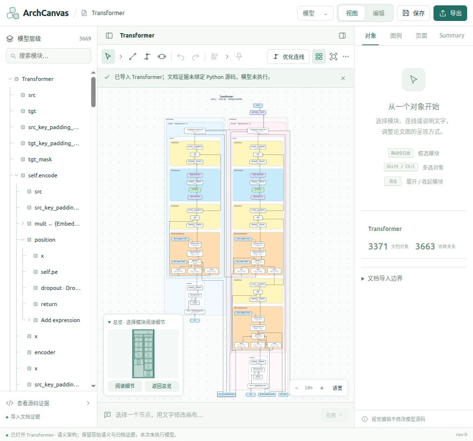
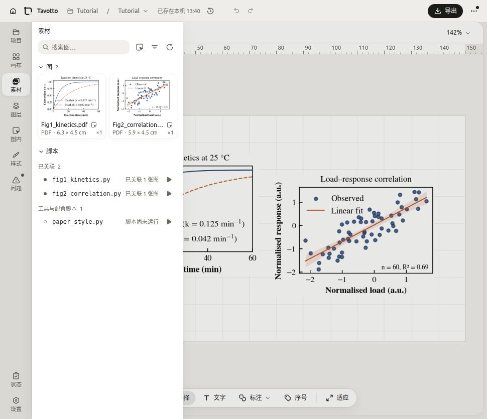
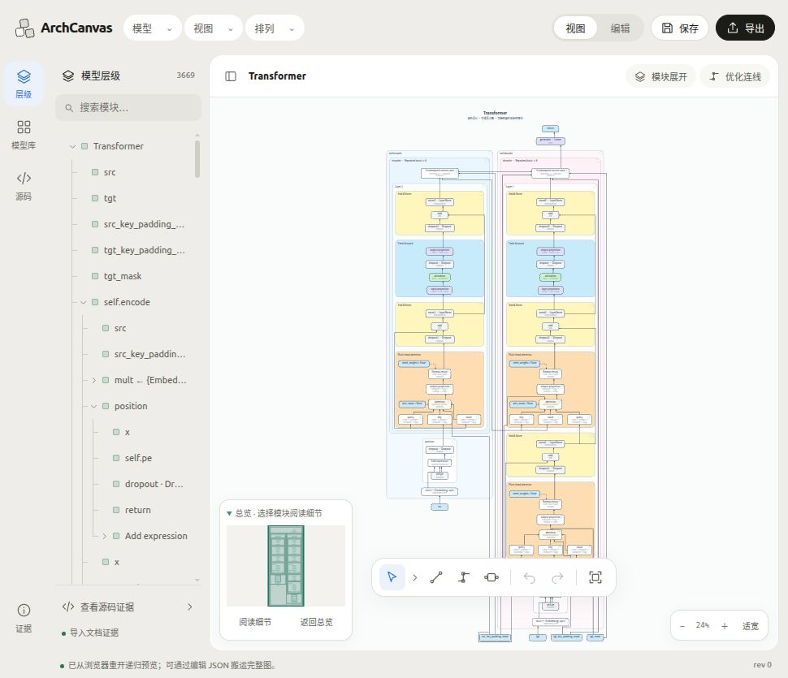
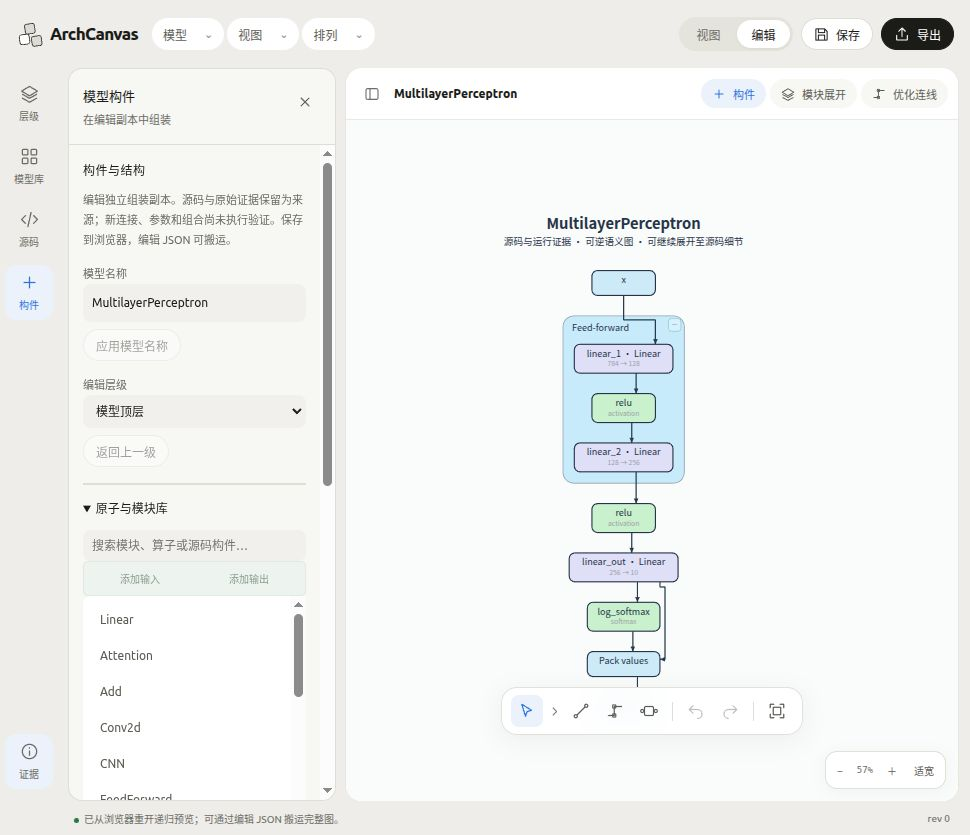

# Tavotto 风格改版与双视角检查 · 2026-10-29

本次直接调整正式 Studio。右侧「对象 / 图例 / 页面 / Summary」常驻面板已经移除；常用流程按「模型、视图、排列」组织。视觉采用 Tavotto 当前源码中的暖灰桌面、白色圆角工作区、黑色主按钮、蓝色选中态及底部浮动工具条。图元的语义配色与已有页面背景仍由模型文档控制。

## 检查方法与边界

这是任务驱动的用户视角模拟，不是真实用户访谈。实际启动了正式主程序和 Tavotto 参考程序，在同一浏览器中操作首页、工作台、侧栏、菜单和弹窗，再据此实现并检查改版。

- 主程序：正式 checkout，端口 8796，测试数据位于 `/tmp/archcanvas-ui-tavotto-20261029`。
- Tavotto：原目录 `Source_Code_Project/Tavotto`；前端复制到 `/tmp/archcanvas-tavotto-reference-20261029` 构建，后端使用独立配置、数据和 Python 环境，在端口 5089 运行。为本地构建补充了源码已有但基础 Vite 配置缺少的 playground runtime JSON 路径别名，未修改参考目录。
- Tavotto 实测使用内置 Tutorial 示例，暂停引导后检查工作台。其 PDF 后端提示缺少批准字体，因此本次不据此认证其 PDF 渲染、导出或源码写回能力；示例图与工作台实际可见。
- 主要视觉证据宽度均为 970 px。改版前截图高 905 px，后续截图高 835 px，所以只比较画布宽度，不把高度变化计作改版收益。
- 尝试设置 680 px 浏览器视口，但当前内嵌浏览器仍返回 970 px；另一个后台标签实际返回 1280 px。小尺寸 CSS 已实现，680 px 的实机布局未据此宣称通过。

参考依据为 Tavotto 的 `web/src/index.css`、`docs/rules/frontend/ui-visual-discipline.md` 和实际工作台。本次独立实现样式与交互组织，没有把 Tavotto 组件或运行时加入正式产品依赖。

## 用户视角：两边的感受与反馈

| 任务 | 改版前 ArchCanvas 的感受 | Tavotto 实际体验 | 改版反馈与取舍 |
| --- | --- | --- | --- |
| 打开工作台、先读图 | 两侧常驻面板挤压画布；右侧常显示空白属性提示 | 暖灰桌面把工具与白色工作区分开，主次更清楚 | 去掉右侧面板；保留较窄模型层级，突出图与模型名 |
| 寻找一个功能 | Summary 标签同时装载模型库、展开、编辑和证据，很难从任务推断入口 | 侧栏按素材、图层等任务切换，低频操作放在菜单中 | 使用「模型 / 视图 / 排列」菜单；「模块展开」「优化连线」保留直接入口 |
| 找模型、开始阅读 | 模型库需要进入 Summary 面板 | 首页提供明确项目入口与示例，工作台有固定导航轨 | 模型库可从模型菜单或左导航打开；支持搜索后直接打开模型 |
| 编辑构件与观察画布 | 操作与大量属性设置混在右侧 | 左侧任务区可收起，底部工具条维持画布操作位置 | 构件区只在编辑模式出现，并与画布同时使用；没有把构件编辑放进模态弹窗 |
| 临时调整展开或布线 | 大量按钮始终可见，增加视觉负担 | 常用工具精简；次要操作按需出现 | 展开深度和预设放入视图工具；优化、对齐、分布与固定放入排列菜单 |
| 用键盘关闭工具 | 原有菜单和弹窗的焦点恢复不完整 | 参考菜单支持 Esc 关闭并回到触发控件 | 修复菜单触发弹窗后焦点丢失、关闭 details 内不可见控件参与 Tab 循环的问题 |
| 首次进入 | 直接载入模型，适合继续工作 | 实测连续出现匿名统计询问、版本提示，然后才到示例入口 | 借鉴其视觉层次与任务组织，保持主程序直接进入工作台的路径 |

在 970 px 宽窗口中，原画布宽 526 px，改版后宽 700 px，增加 174 px（约 33.1%）。这不是模型渲染性能指标，也不是相同高度下的画布面积指标。

## 程序员视角：反馈对应的修复

| 用户问题 | 实现 | 验证 |
| --- | --- | --- |
| 右侧面板占用空间 | 删除 App 中右侧 inspector JSX 与标签状态；移除底部低频视觉命令输入栏 | 浏览器 DOM 不再存在 `aside.inspector`；测量画布宽度 |
| Summary 入口含义不明确 | 分拆为模型库、模块展开、证据对话框，以及独立构件工具区 | 搜索 MultilayerPerceptron 并打开；通过新入口操作展开预设 |
| 连线优化入口分散 | 排列菜单整合优化、布线设置、继续布线、八种对齐/分布、固定和移动范围 | 实际优化返回「9 条路径已优化，0 条保留合法路径 · 节点位置不变」 |
| 构件编辑离不开画布 | 编辑模式打开左侧构件区；与层级区切换；隐藏时保留挂载与表单状态 | 模型编辑、工具区切换、弹窗开关与画布选择联动检查 |
| 开临时工具后丢失构件区 | 将构件区状态与模态工具状态分开 | 打开模块展开再关闭，保留原构件工具区 |
| 菜单/弹窗键盘体验不一致 | 统一 Esc、方向键、外部点击；弹窗内 Tab 循环；返回菜单 summary 或原按钮 | 实测 Shift+Tab 返回「展开预设」summary；Esc 返回「视图」菜单触发项 |
| 弹窗误操作背景画布 | 模态工具打开时屏蔽背景画布快捷键；构件区保持可同时操作画布 | 应用快捷键门控与模态焦点检查 |
| 导出窗口体验不一致 | 统一色调、选中态与圆角；原生预览导出接入焦点管理 | 实际生成 SVG，出现「文件已生成 · SVG」及下载和收据链接 |
| 测试桩早于既有运行状态字段 | 补齐 previewApp 测试中缺少的 `setPreviewCanCancel` 桩 | 相关 22 项 App 回归测试通过；未修改该字段的产品实现 |

关键实现：`studio/src/App.tsx`、`WorkspaceUI.css`、`WorkspaceUI.tsx`、新增的 `WorkspaceDialog.tsx`。嵌入画布的工具外观位于 `studio/public/preview/yworks_edge_router_lab/studio-embed.css`，对应 integration manifest 摘要已同步。

## 功能迁移与 API 保留

| 原位置/功能 | 新位置 |
| --- | --- |
| 对象、图例、页面标签与低频视觉输入控件 | UI 删除；文档字段、视觉操作与桥接协议保留 |
| Summary 模型库 | 模型 → 浏览模型库；左导航「模型库」 |
| 模块展开深度、F0/F1 阅读预设、局部恢复 | 视图 → 模块展开与预设；画布标题栏「模块展开」 |
| 连线优化、布线设置、继续布线 | 排列菜单；标题栏「优化连线」 |
| 对齐、分布、固定、移动作用范围 | 排列菜单 |
| 模型组装、原子库、源码构件及精确连接 | 编辑模式 → 构件工具区 |
| 运行观察与语义证据 | 模型菜单与左导航「证据」 |
| 源码文本 | 左导航「源码」与模型菜单，底部只读抽屉 |
| 正式源码工作副本 | 模型菜单，继续使用独立 AuthoringStudio |

保留 `PreviewHandle` 的 `command / visual / author / source / svg / snapshot / save` 接口，及原有节点、边、页面、图例、说明等文档/视觉 API。没有改变 Summary 图引擎、Worker、IR、源码身份、导出事务或后端解析流程。React 负责界面容器与入口，实际展开、排版、保存和编辑继续由原权威模块处理。

## 验证结果与发布边界

- `npm run build`：通过。Vite 仍提示现有主 bundle 大于 500 kB。
- `npm run audit:preview`：通过。该检查仅覆盖前端模块/Worker 依赖边界，不代表全产品认证。
- 相关回归组：90/90 通过，日志 `evidence/ui-tavotto-20261029/regression-tests.log`。
- 原生语义视图、作者编辑和证据回归：34/34 通过，日志 `semantic-tests.log`。
- 最终工具状态调整后复查 App 与运行证据：28/28 通过，日志 `final-shell-tests.log`。这是前面用例的复查，不重复累加数量。
- 另运行层级与桥接旧测试：13 项中 7 项通过、6 项失败。5 项要求当前含连接引导包装的树 HTML 与旧存档逐字相同；1 项桥接测试缺少已存在的 `changeFrontier` 依赖。相关产品文件与测试文件均与 HEAD 完全相同，摘要证据见 `baseline-test-files.json`，失败详情见 `existing-test-mismatches.log`。这些原有失配尚未修改，因此本次不能声称全量测试通过。
- `git diff --check`：通过；嵌入样式的 manifest 摘要和 dist/public 内容一致。

浏览器已完成模型搜索/切换、保存重开、展开预设、连线优化、构件区、源码与证据入口、菜单键盘操作、弹窗焦点及实际 SVG 生成。没有执行新的 CPU 模型观察、源码提交或发布部署。

## 视觉证据

改版前：

Tavotto 当前工作台：

改版后：

构件编辑：

展开工具和导出结果分别见 `studio-expansion.jpg`、`studio-export.jpg`。
