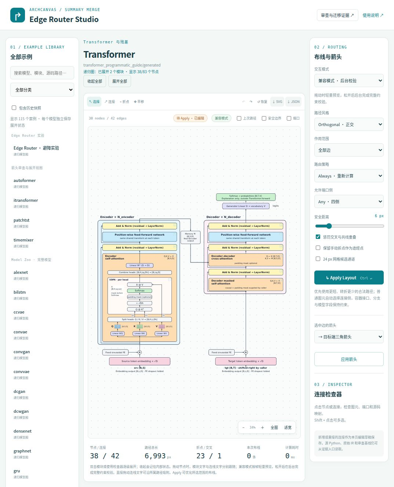

# 转折和分岔的边框留白修复

本次修复位于 Summary_Merge 的共享路由层，适用于所有模型的收起、混合展开、完全展开、Apply，以及兼容/实时拖动。没有重生成 catalog、模型源码、IR 或 snapshots。

## 行为

- 容器四边的内外通道优先保留 12 个画布单位的留白；嵌套容器、邻接图元和所属文字占用空间时，按可用通道宽度自适应居中，始终保留原来的描边安全间距。
- 同一源码张量的共享主干一起调整分岔位置。沿主干经过的边界接口按行进顺序处理，避免先到分岔点再折返接口。
- 端口、合法边界接口、包含关系、producer/consumer 和 canonical binding 仍由原语义验证器约束。12 单位是视觉首选，不是阻止移动的硬条件。
- 狭窄源码接口或复杂局部搜索无法满足首选留白时，保留或重求解经过验证的安全线路，并在 `validateView().routing.contacts` / `constrained` 报告受限边。移动或展开改变几何后重新优化。不能将合法性检查通过解释为所有线路都达到 12 单位。
- v9 缓存升级到 v10，保留展开选择、手动偏移和标签锚点。

## 可复验的前后对比

`comparison.json` 使用同一个 Transformer 混合展开状态（Attention 与 FFN 展开），节点、坐标、源码证据和绑定保持一致，仅比较连线路径。

| 位置 | 修复前 | 修复后 |
| --- | ---: | ---: |
| 残差分岔水平线到 Attention 下边框 | 4.1 | 12 |
| 残差侧通道到 Attention 左边框 | 9.6 | 12 |
| Memory 输出转折到 Encoder 上边框 | 4.65 | 12 |

单位为画布坐标。执行 `node prototype/Summary_Merge/verification/boundary-turns/compare.cjs` 可重新检查保存的图快照与源码身份，并输出指标。`transformer-before.json` 来自本轮修改前的代码，`transformer-after.json` 来自修复后代码。

## 验证

- `catalog-check.json`：114 个案例、339 个初始/单分支/全部展开状态，路由、源码、边界、节点和不同张量通道校验均无失败。扫描约 384 秒。
- `all-tests-final.log`：全量 78 项，77 项通过；唯一失败为共享分支测试使用严格浮点相等比较 390 与 389.99999999999994。测试按几何验证器的 1e-5 容差修正，产品代码未再改变；`fan-out-recheck.log` 记录该项复验通过。其余 77 项结果仍适用。
- 覆盖四方向内外留白、窄通道 CCVAE、部分/完全展开、残差和 Q/K/V 共享分支、子节点/Memory 别名/容器移动、标题及连线文字跟随、箭头末端、边界描边与绑定防篡改。
- 浏览器实际拖动：兼容和实时模式均成功，分别保存 `browser-compat-move.svg` 与 `browser-realtime-move.svg`。随后撤销测试位移，恢复兼容模式与原有两个模块展开状态。界面保存状态包含 Attention 和 SDPA 展开，与上方机器对比的 FFN 展开状态不同。
- `reference-integrity.json`：只读参考目录 `Summary_Merge（复件）` 的 12,533 个文件，修改/缺失/新增均为零。

## 界面证据

当前预览：<http://127.0.0.1:8766/yworks_edge_router_lab/index.html?case=01093cc06a87b35a>

`browser-before.png` 是升级前界面；`browser-final.svg`、`browser-final-dom.json` 是撤销测试位移后的实际渲染。源码身份与机器对比指标见 `comparison.json`。
