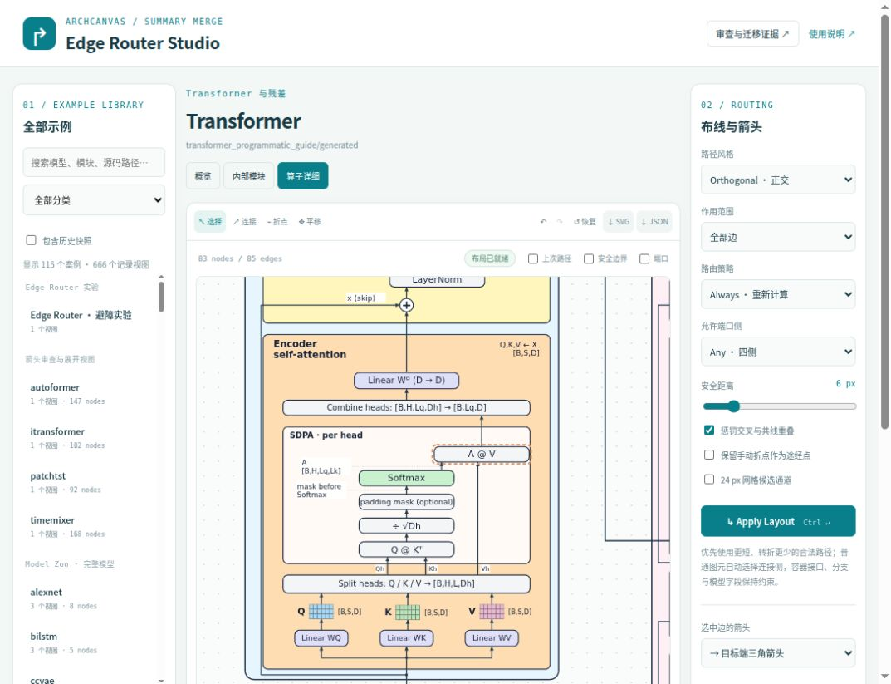

# 连线文字跟随与边框笔画间距

2026-10-12。入口：[统一编辑器](../../yworks_edge_router_lab/index.html?case=01093cc06a87b35a&view=detailed)。

连线文字之前按模块附件渲染，移动或重新布线后无法沿线跟随。现在源生成器直接声明 caption → canonical route / IR trace，导入器保存不可变身份和可编辑路径锚点。模块标题、张量图元的角色与形状仍分别绑定模块和值。没有使用最近连线来猜测语义。

- Transformer 两版明确登记 x(skip)、Qh/Kh/Vh、A 的形状和 mask-before-Softmax；紧凑版的两条语义说明分开登记。
- Model Zoo、模块库、时序模型从实际连线绘制调用传入准确 route ID；展开审查视图由相同 canonical dependency 和文本匹配迁移。共 **236 个连线标签，5 个集合**。
- 标签随正交、八方向及曲线路径定位，可单独拖动沿所属连线吸附，支持 undo/redo、保存和 SVG/JSON 导出。短间隙放不下文字时使用空白侧栏和细引线，不遮住模块。源连接、caption 内容和身份受保护，只有路径位置可编辑。
- 边框原来只检查完全共线的中心线，漏掉了 1–4 px 的笔画重叠。共享求解器、移动修复和验证器现在统一使用 **线条半宽 + 边框半宽 + 2 px 留白**。检查包括短段，合法接口仍可垂直穿越。
- 同源共享干线分叉点可在边框前后调整，靠近容器角落的接口在同侧安全范围内调整，保持 canonical source/destination、分支及包含关系。旧草稿加载时仅修复受影响路径，保留用户模块位置。

## 当前验证

| 验证 | 结果 | 证据 |
|---|---|---|
| 当前视图与连线笔画间距 | 328 视图，5,538 边，89,656 个 frame/segment 对，0 问题 | [border-clearance.json](border-clearance.json) |
| 连线标签 | 236 个，0 路径脱离、0 图元/标签覆盖 | [audit.json](audit.json) |
| 编辑器回归 | 41 项通过 | [engine.log](engine.log) |
| 导入语义保护 | 328 视图，4,002 负例均拒绝 | [contracts.log](contracts.log) |
| 三种显示路径 | 0 问题、0 不同张量共线重叠 | [display.log](display.log) |
| 原生源码/IR/SVG | 7 组通过；Transformer 31 个损坏负例 | [native.log](native.log) |
| 完整目录与标签保留 | 230 案例、665 导入视图、5,727 快照文件 | [catalog.log](catalog.log) |
| 复杂图全图布线 | TimeMixer、Autoformer、Transformer、展开 TimeMixer，0 失败 | [full-routes.log](full-routes.log) |

浏览器实测：A@V 移动后标签锚点由 `(382,1289)` 跟随路径变化；x(skip) 沿同一残差线拖动从 `(167.68,950)` 到 `(296.95,950)`，撤销/重做分别恢复；最终 Apply 路由 67 条，85 条边全部有效。旧草稿的残差通道由 `x=78` 调整到 `x=75.9`，与 `x=80` 容器边框留出绘制间距。

见 [拖动及历史 DOM](browser-final.json)、[最终 Apply DOM](browser-applied.json)、[截图](final.png)。

这是独立复刻的路由与展示实现。模型未执行；历史快照按原样保留，没有用几何关系补造模型事实。检查通过覆盖当前登记图和测试场景，不代表任意布局都能找到全局最短解；无法满足约束的拖动会回退或标出失败。
